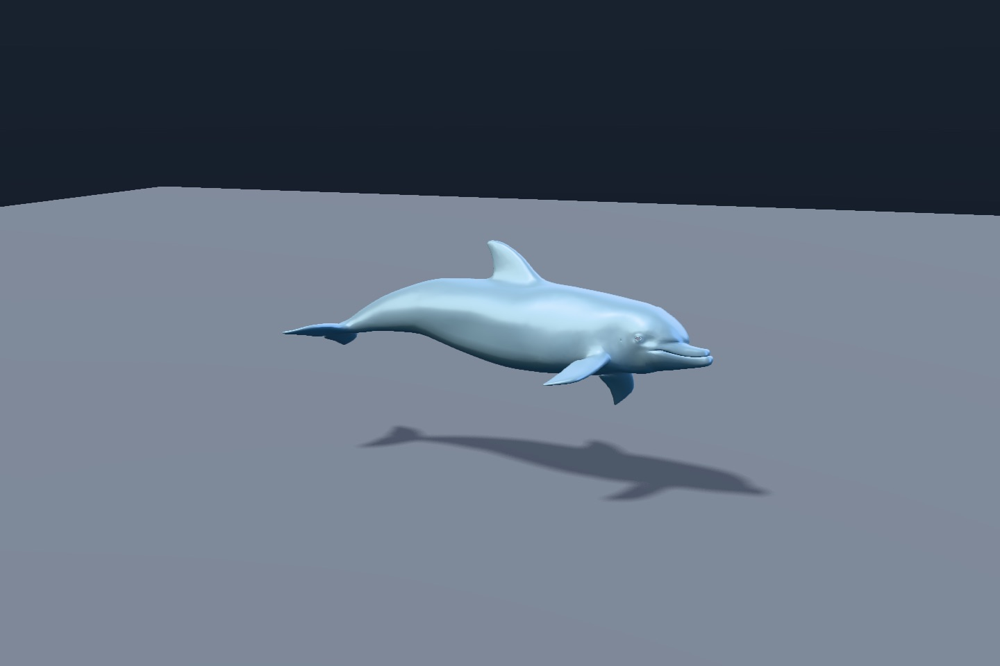

# Animation mixing, camera control, picking, and export



The Animation Lab plays the bundled dolphin's imported swim cycle on its skeleton
and mixes it with clips written in Swift: a cruise path, a leap that
cross-fades in and out, and an additive roll. `PreparedGLTFScene.posing(_:)`
recomputes joint palettes from the mixed graph. A damped
`OrbitCameraController` frames the scene.
[Scene source](../../Examples/FrostfieldLab/FrostfieldLab/LabAnimationLab.swift)

| Capability | API | Verified by |
| --- | --- | --- |
| Weighted clip blending, cross-fades with warp, loop modes, time scale, additive layers, events | `AnimationMixer`, `AnimationAction`, `AnimationClip` | `AnimationMixerTests` |
| glTF morph targets (positions, normals, tangents, sparse accessors, weights channels) and CPU application | `GLTFMeshLoader.loadScene(..., includeMorphTargets: true)`, `MeshMorphTargets` | `GLTFMorphTargetTests` |
| Orbit, map-style pan, zoom to cursor, framing, and fly controls with frame-rate-independent damping | `OrbitCameraController`, `FlyCameraController` | `CameraControllerTests` |
| BVH ray queries matching the linear scan; cached for undeformed meshes in scene picking | `MeshBVH`, `MeshGeometry.intersection(..., bvh:)` | `MeshBVHTests` |
| Bounds and view frustum tests for forward and reversed depth | `AxisAlignedBox`, `BoundingSphere`, `ViewFrustum` | `ViewFrustumTests` |
| Box selection, mixed viewport raycasts and grouped input | `SceneGraph.select`, `SceneGraph.raycast`, `SceneInteractionGroup` | `SceneSelectionTests`, `PrimitivePickingTests`, `BatchedMeshTests` |
| glTF 2.0 and GLB export of imported scenes and scene graphs | `GLTFExporter` | `GLTFExporterTests` |

The exporter round-trips a procedural scene through GLB with bit-identical
vertices and indices, texture pixels within one code value, and matching light,
camera, and animation samples. It reports every lossy conversion, such as
dropped surface-graph channels or omitted rectangle lights, as a warning.

## Selection and input

`SceneSelectionRectangle` takes top-left normalized drawable coordinates in
either drag direction. The graph tests the transformed centers of the current
mesh and primitive bounds, including posed meshes, or each instance's
transformed origin. It respects visibility, camera layers, and the unjittered
view's clip planes. An explicit `ShaderGraphCamera` also supports orthographic,
off-axis perspective, and reversed-depth views. Results preserve node and
instance order. A perspective query can override the far plane along the
camera's negative Z axis. Batch selection includes individually hidden active
slots under visible scene nodes and returns stable batch handles.
[Three.js r187 SelectionBox](https://github.com/mrdoob/three.js/blob/r187/examples/jsm/interactive/SelectionBox.js)

`SceneGraph.intersections` returns every visible mesh triangle under a camera
or world ray, nearest first. Hits include instance and triangle indices,
barycentric weights, interpolated top-left UVs and surface normals. Nearest and all-hit
queries share the same static and curve-flow BVHs. Skinned, morphed and
shader-deformed geometry uses the current pose. `SceneGraph.raycast` adds
points, lines and sprites to the same distance-ordered list. The viewport
query uses the renderer's homogeneous projection and vertical scale for
pixel and world sizes, including orthographic and off-axis views. Sprites
return texture coordinates in their atlas regions. Lines report the
perspective-correct centerline parameter after clip-plane trimming.
[Three.js r187 Raycaster](https://github.com/mrdoob/three.js/blob/r187/src/core/Raycaster.js)

`SceneInteractionGroup` accepts pointer phases from a native gesture recognizer
or a world ray from spatial input. Viewport events reach the nearest drawable
among the group's direct children. With a render camera and viewport size,
controller rays can also route to points, lines and camera-facing sprites.
The host owns its event subscriptions. Handler removal takes effect on the
next dispatch. The tests check routing past a closer external node and a
nested child, sprite UV delivery, hidden targets and handler removal.
[Three.js r187 InteractiveGroup](https://github.com/mrdoob/three.js/blob/r187/examples/jsm/interactive/InteractiveGroup.js)

At `c783bcf`, the selection, primitive picking and batch suites passed on
macOS and iPhone 18 Pro Simulator with Metal API Validation in Xcode 27.2.
The full macOS run passed 1,198 tests. The focused iPhone run passed 110 tests.

## Animation Lab runtime

| Runtime | Observed |
| --- | --- |
| M4 Max Mac Studio, macOS 27.2 | Capture after 1.5 seconds of mixing with Metal API Validation. |
| iPhone 18 Pro Simulator, iOS 27.2 | [Live controls](scene/animation-lab-iphone.jpg) with Metal API Validation. |
| Apple Vision Pro Simulator, visionOS 27.2 | [Windowed scene](scene/animation-lab-vision.jpg) with Metal API Validation. |

```sh
FrostfieldLab.app/Contents/MacOS/FrostfieldLab --capture-animation-lab /tmp/leap.png 1440 960 --set motion.leap=1
```
