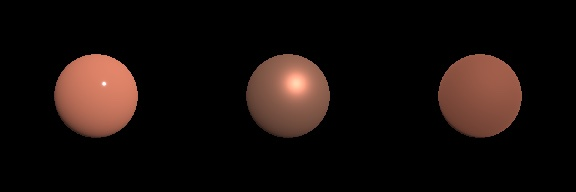
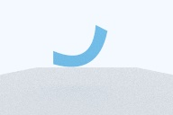

# Animation tracks, bindings, IK, tweens and compute skinning



One `AnimationClip` played by `AnimationMixer` drives the roughness and metalness of a
prepared material through `PhysicallyBasedMaterial.LiveFactors`. The frames above are
raster renders at 0, 1 and 2 seconds (roughness 0.1, 0.5, 0.9; metallic 0, 0.5, 1).



A two-joint strip re-posed by `PathTracingScene.updateGeometry` with `computeSkinning`
set, path traced at 64 samples per pixel under a constant sky.

| Capability | Public API | Raster / path tracer | Verified by |
| --- | --- | --- | --- |
| Typed keyframe tracks: number, vector2/3/4, quaternion, linear color, boolean, string | `AnimationTrack`, `AnimationValue`, `AnimationTrack.number/vector/quaternion/color/boolean/string` | CPU | `AnimationTrackTests` |
| Interpolation: step, linear (shortest-arc slerp for quaternions), Three.js `InterpolateSmooth` with its zero-curvature endings, glTF cubic spline | `AnimationTrack.Interpolation` | CPU | `AnimationTrackTests` |
| Typed property paths for node TRS, morph weights (all or one), tint, shadow casting, light color, intensity, range and spot angles, camera projection and pose, environment intensity and yaw, shader uniforms, material factors, light-rig lights, glTF camera projections and custom values | `AnimationProperty`, `AnimationClip(name:tracks:duration:)`, `AnimationMixer.apply(to:)` for graphs and rigs, `applyLiveProperties()`, `value(of:rest:)` | Both renderers | `AnimationBindingTests` |
| Three.js binding path strings for node properties (`"Face.morphTargetInfluences[smile.L]"`, `"Armature.001.position"`, `".position"`, `"Lamp.intensity"`); keys and node names may contain dots | `AnimationProperty(path:nodes:defaultNode:morphTargetNames:)` | — | `AnimationBindingTests` |
| Blending of typed properties with Three.js `PropertyMixer` rules: weighted average with rest fill, additive offsets, `_select` for booleans and strings, and additive booleans and strings that replace the blend at weight ≥ ½ | `AnimationMixer` | — | `AnimationBindingTests` |
| Material factors that change after preparation: base color, metallic, roughness, emissive factor and strength, normal scale, occlusion strength, alpha cutoff, texture transforms of the five core maps, clearcoat, transmission, specular, sheen, iridescence and anisotropy factors | `PhysicallyBasedMaterial.withLiveFactors()`, `LiveFactors`, `Factors`, `PathTracingScene.updateMaterials()` | Raster copies the current factors into each draw; the path tracer repacks its material buffer, with every texture and sampler at its prepared table index, and increments `revision` | `LiveMaterialRenderingTests` |
| `KHR_animation_pointer` import: node TRS and weights, material factors, `KHR_texture_transform`, `KHR_lights_punctual` color, intensity, range and cone angles, camera `yfov`, `aspectRatio`, `znear`, `zfar`, `xmag`, `ymag`. Other pointers are skipped and listed unless the asset requires the extension; pointers to a material that no drawn primitive uses are skipped when binding; export reports dropped pointer channels | `GLTFAnimationClip.pointerChannels`, `unsupportedPointers`, `GLTFAnimationPointer`, `AnimationClip(_:in:)`, `PreparedGLTFScene.animationClip(_:)`, `materialFactors`, `lightNodeIDs`, `cameraView(nodeIndex:in:viewportAspectRatio:animatedBy:)`, `GLTFExporter.Warning.animationPointersDropped` | Both renderers | `KHRAnimationPointerTests` |
| Subclips by frame with exact boundary keys, held ends past a track's keys, additive clips kept additive, and glTF weights channels kept on the morph path | `AnimationClip.subclip(name:startFrame:endFrame:framesPerSecond:)` | — | `AnimationTrackTests`, `AnimationBindingTests` |
| Remove redundant flat-run keys while preserving timing, spline keys and imported morph bindings | `AnimationTrack.optimized()`, `AnimationClip.optimized()` | CPU | `AnimationTrackTests`, `GLTFMorphTargetTests` |
| Additive clips from a reference frame, including typed tracks; boolean and string tracks kept unchanged | `AnimationClip.makingAdditive(referenceTime:reference:)` | — | `AnimationBindingTests`, `AnimationMixerTests` |
| Merging single morph weight tracks, for normal and additive clips; morph-target sequence clips | `mergingMorphWeightTracks(restWeights:)`, `AnimationClip.morphTargetSequence(...)` | — | `AnimationTrackTests`, `AnimationBindingTests` |
| Full local turns, axis scale, seeded shake and pulse, inherited visibility and material RGB clips | `AnimationClipCreator`, `AnimationProperty.Node.isVisible`, `AnimationProperty.Material.baseColorRGB` | Native scene and live material bindings | `ProceduralAnimationTests`, `ProceduralAnimationSceneTests` |
| One clip driving several objects, with live membership or fixed replication | `AnimationObjectGroup`, `AnimationMixer.addAction(for:on:)`, `AnimationClip.replicated(onto:)` | CPU pose | `AnimationObjectGroupTests`, `AnimationBindingTests` |
| Retargeting normal and additive clips between skeletons with different joint frames and proportions, and cloning a prepared skinned hierarchy | `AnimationSkeleton`, `AnimationClip.retargeted(from:to:boneNames:framesPerSecond:translationScale:)`, `PreparedGLTFScene.cloned()` | CPU pose, shared GPU geometry | `AnimationRetargetTests`, `PreparedGLTFSceneTests` |
| Cyclic coordinate descent IK with hinge and Euler limits and a blend factor | `CCDIKChain`, `CCDIKChain.solve(in:target:)` | — | `InverseKinematicsTests` |
| Easing: tween.js Penner family and `generatePow`, CSS `cubic-bezier()` and `steps()` | `Easing` | — | `TweeningTests` |
| Tweens with delay, repeats and yoyo; exactly integrated springs; exponential damping for scalars, vectors and rotations | `Tween`, `Spring`, `Damping` | — | `TweeningTests` |
| Compute skinning for many meshes in one pass | `ComputeSkinning`, `PathTracingScene.computeSkinning`, `PathTracingScene.Statistics.computeSkinnedBuildCount` | Path tracer geometry updates | `ComputeSkinningTests` |

## Checks against reference values

- Cubic spline tracks reproduce `t³ − 2t + 1` from exact tangents within 1e-5.
  Smooth tracks equal the Three.js `CubicInterpolant` basis, reproduce `t²` exactly
  between interior uniform keys, and reduce to a line for two keys.
- A subclip from 0.5 s to 3.5 s matches the source at 61 times within 2e-5 for
  linear, step, smooth, cubic spline and quaternion tracks. Subclips over five
  ranges of a clip whose cubic and smooth tracks start late, end early or lie
  inside the range match the source at 81 times within 1e-5, including where a
  track holds its end value (before the fix: 0.625 against 0 for a cubic track
  starting at 1 s).
- Subclips and merged morph tracks of additive clips stay additive: sampled
  offsets match the source within 1e-5, and mixer weights match within 1e-6.
  Subclips, merges and replicas of an imported skinned morph clip keep the
  weights channel on the `morphWeights(for:rest:)` path and move the joint like
  the source clip within 1e-5.
- Optimization keeps both endpoints of repeated step or linear keys. It
  preserves cubic and smooth interpolation and leaves additive reference
  values intact. A loaded glTF morph clip retains its original mixer weight
  channel and values after compression. Xcode 27.2 with Metal API Validation
  passed 69 focused tests on Mac and iPad Simulator via `xcodebuild` after the
  bridge timed out resolving the workspace destination.
  [Three.js r187 key optimization](https://github.com/mrdoob/three.js/blob/r187/src/animation/KeyframeTrack.js)
- The procedural rotation factory samples a full local turn using quaternion
  quarter turns. Axis scaling preserves the supplied scale on the other two
  axes. Shake and pulse sample at 10 Hz and accept a repeatable seed.
  Visibility and RGB clips round-trip through archive v25. A rendered fixture
  confirms inherited visibility and that an RGB clip preserves live alpha.
  When a whole base-color factor and an RGB track both play, the RGB track
  controls RGB and the whole factor controls alpha.
  Xcode 27.2 passed all 66 focused tests on Mac and iPad Simulator with
  Metal API Validation. Verification used `xcodebuild` after the Xcode
  bridge timed out resolving the workspace destination.
  [Three.js r187 clip factories](https://github.com/mrdoob/three.js/blob/r187/examples/jsm/animation/AnimationClipCreator.js)
- An action samples a group's node tracks once and writes the results to
  each active member. A member can join an in-flight fade, leave while
  keeping its mapping cached, or release the mapping with `uncache`.
  The mixer keeps each member's rest pose for weighted and additive
  blending. Shared non-node bindings contribute once per action. All 65
  focused tests passed on Mac and iPad Simulator with Metal API Validation.
  [Three.js r187 animation groups](https://github.com/mrdoob/three.js/blob/r187/src/animation/AnimationObjectGroup.js)
- Live material factors render bit-identically to a material made with the same
  factors, including an animated base color texture offset and rotation. An
  animated emissive factor and strength renders `factor × strength` within 0.002.
- After `updateMaterials()`, a path-traced emissive surface matches a fresh
  `PathTracingScene` of the same factors within 1e-3, and `revision` advances once.
  When a live clearcoat with a factor map packed before another material's
  emissive map turns off, back on, or is off at preparation, the second material
  still traces its own green texture within 0.01 (before the fix it traced the
  first material's red map).
- A `KHR_animation_pointer` fixture sampled at 0.5 s gives roughness 0.35, light
  intensity 15, a light at y = 0.75 and a camera `yfov` of 0.625, and renders
  bit-identically to a static asset authored with those values.
- Retargeting onto a skeleton with rolled joint frames and twice the bone lengths
  places every joint at twice the source offset from the root within 1e-4 at all
  11 sampled frames. The same holds when the source frames are rolled too, the
  target hips are scaled by 1.5 under an unmapped armature rotated 90° and scaled
  by 0.5, and child offsets therefore differ from bone lengths. A target root
  scaled by two moves twice as far as the source root.
- Additive retargeting applies source offsets to the source rest pose and
  writes offsets relative to the target rest pose. Reapplying the target
  offsets reproduces the equivalent normal clip. A prepared glTF clone
  shares its mesh renderers and uses fresh joint and draw IDs. The test plays
  different times on the original and clone in the same graph and reads
  distinct deformed positions from their palettes. The Xcode 27.2 focused
  Mac run passed 37 tests with Metal API Validation. The Xcode bridge timed
  out resolving the package destination, so verification used `xcodebuild`.
  [Three.js r187 SkeletonUtils](https://github.com/mrdoob/three.js/blob/r187/examples/jsm/utils/SkeletonUtils.js)
- CCD reaches reachable targets within 1e-3; a 0–45° hinge asked for 90° stops at
  exactly 45° about its axis; Euler limits hold within 1e-4.
- A critically damped spring released from rest never crosses its target and
  settles within 1e-6. One 1/30 s step equals four 1/120 s steps within 1e-6 in
  position and 1e-5 in velocity; thirty 1/30 s steps equal 120 1/120 s steps within
  1e-5 in position and 1e-4 in velocity for critical, underdamped and overdamped
  springs.
- CSS `ease` at 0.5 is 0.8024033877 and matches a 200-step bisection reference
  within 1e-9 at 101 points. Outside zero to one the curve follows the CSS
  tangent rules, including `cubic-bezier(0, 0.5, 0.5, 1)` at −0.1 giving −0.2.
- Compute skinning equals `MeshSkin.deform(_:using:)` within 1e-5 in position,
  normal and tangent for meshes with 9 and 64 joints, nonuniform and mirrored joint
  scales and both tangent handednesses. A path-traced compute-skinned node matches
  the CPU-skinned scene within 1e-3 with identical coverage, and
  `computeSkinnedBuildCount` shows that both rebuilds used the compute pass.

Each new test was run against deliberately broken code (live factors ignored at
encode or pack time, kernel weight dropped, double skinning, wrong slerp arc,
altered smooth basis, missing hinge clamp, missing rest correction and others) and
failed. After review, each fix was reverted on its own and its test failed: texture
reservation, held-end tangents (boundary and neighbor), weights channels kept as
channels, additive blend mode and merged references, additive discrete selection,
bracket parsing, the CSS tangent rule, bone lengths from world positions, the
parent's scale in root motion, the source rest correction, skipping unbindable
pointers, skipping undrawn variant materials, the export warning, and the compute
path in path-tracer updates.

## Measurements

Apple M4 Max Mac Studio, macOS 27.2 (26B123), Xcode 27.2 (27B52), Release build,
Metal API Validation off. Ten skinned spheres of 33,151 vertices with 64 joints
and four random influences per vertex. The benchmark test ran in three separate
processes; each warmed up for 5 iterations, then ran 3 runs of 20 back-to-back
iterations per path. The table gives the range of the nine run medians and the
10th–90th percentile of all 180 samples per path.

| Path | Run medians | p10–p90 |
| --- | ---: | ---: |
| Compute pass, GPU time from command-buffer timestamps | 0.19–0.20 ms | 0.19–0.24 ms |
| Compute pass, encode, commit and wait on the CPU clock | 0.35–0.42 ms | 0.35–0.51 ms |
| `ComputeSkinning.skin(_:queue:)`, including readback to ten `MeshGeometry` values | 2.68–4.54 ms | 2.68–3.68 ms |
| `MeshSkin.deform(_:using:)` on the CPU, one thread | 6.75–6.97 ms | 6.67–7.04 ms |

The GPU pass takes about 1/35 of the CPU loop's time, but reading the vertices
back to `MeshGeometry`, which path-tracer updates do, takes most of the GPU path's
time, so skinning with readback is about 2.4 times faster than the CPU loop.
Single samples reached 17 ms with readback and 2.5 ms for a wait, so these are
typical costs on an otherwise idle Mac, not bounds. The largest GPU–CPU vertex
difference in the correctness tests is 1.19e-7. Raw samples:
[animtools-compute-skinning.json](data/animtools-compute-skinning.json).

```sh
TEST_RUNNER_FROSTFIELD_BENCHMARK=1 TEST_RUNNER_FROSTFIELD_BENCHMARK_OUTPUT=/tmp/skinning.json \
  xcodebuild test -configuration Release -scheme Frostfield-Package -destination 'platform=macOS,arch=arm64' \
  -only-testing:FrostfieldTests/ComputeSkinningTests
```

Integration tests exercise live layer edits with both baked textures and
full-resolution sampling. They also cover blended opacity on software and
automatic acceleration, and a material edit made while the asynchronous scene
builder is constructing acceleration levels.

## Limits

- Raster draws still skin in the vertex stage. `ComputeSkinning` output is not yet
  bound by `MeshRenderer`, so color and shadow passes each skin again; only path
  tracing geometry updates use the compute pass, and they read the vertices back
  because the bottom-level BVH is built on the CPU. Preparing a `PathTracingScene`
  always skins on the CPU.
- Live factors cannot activate a clearcoat, transmission, sheen, anisotropy or
  iridescence layer that was inactive when the material was made, or animate maps,
  layers' textures, IOR, thickness or attenuation.
- `KHR_animation_pointer` pointers outside the table in `GLTFAnimationPointer`,
  including `KHR_node_visibility` and single array elements, are skipped and listed
  in `unsupportedPointers`, or fail to load when the asset requires the extension.
  Pointers to materials, lights or cameras that were not loaded, and to materials
  no drawn primitive uses, are skipped. `GLTFExporter` does not write pointer
  channels; it reports them with `animationPointersDropped`.
- Smooth tracks use only Three.js's default zero-curvature ending; the zero-slope
  and wrap-around endings are not offered. Smooth quaternion tracks are rejected,
  as in Three.js.
- Retargeting samples the source at a fixed frame rate and assumes both skeletons'
  rest transforms show the same reference pose and use uniform joint scales. The
  root joint's ancestors must be unmapped (they hold their rest pose). Additive
  clips are rejected.
- `AnimationProperty(path:)` parses node properties only: Three.js object paths
  such as `.material.roughness`, `.material[1].opacity` and `.bones[Hips].position`,
  directory prefixes and component accessors like `.position[x]` are not parsed;
  build those properties as typed values instead.
- An additive boolean or string with weight below one half leaves the normal blend
  unchanged; Three.js would restore the rest value there.
- CCD offers free, hinge and Euler-box constraints; there are no cone or twist
  limits, and links must be ancestors of the effector.
- `Tween` interpolates numbers, vectors, colors and quaternions only.

```sh
xcodebuild test -scheme Frostfield-Package -destination 'platform=macOS,arch=arm64' \
  -only-testing:FrostfieldTests/AnimationTrackTests -only-testing:FrostfieldTests/AnimationBindingTests \
  -only-testing:FrostfieldTests/LiveMaterialRenderingTests -only-testing:FrostfieldTests/KHRAnimationPointerTests \
  -only-testing:FrostfieldTests/AnimationRetargetTests -only-testing:FrostfieldTests/InverseKinematicsTests \
  -only-testing:FrostfieldTests/TweeningTests -only-testing:FrostfieldTests/ComputeSkinningTests
```
