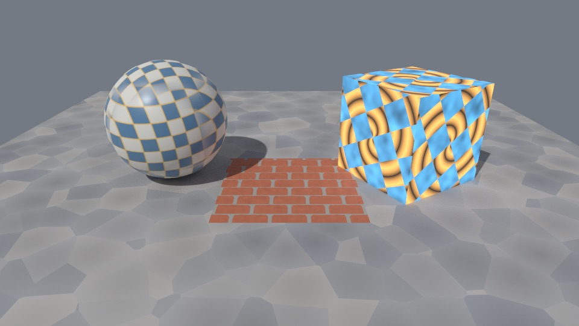
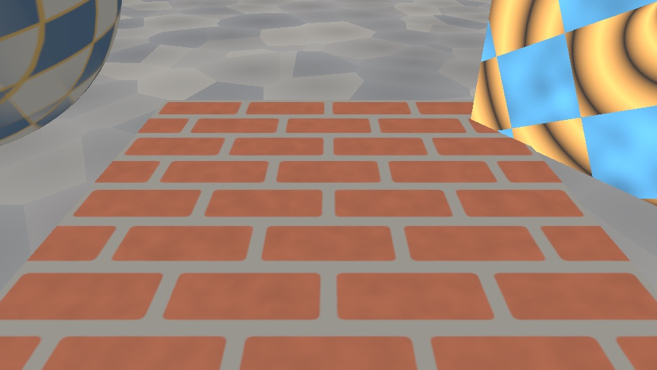
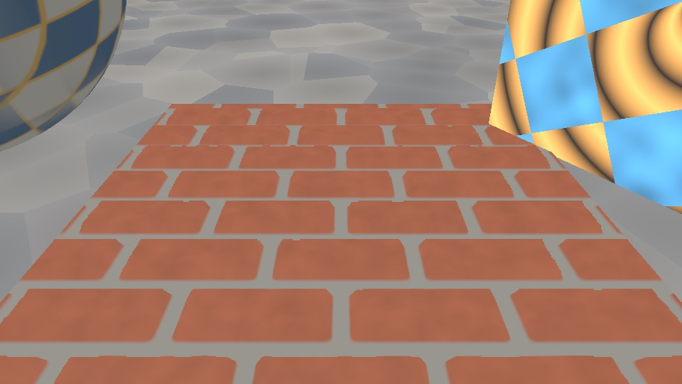
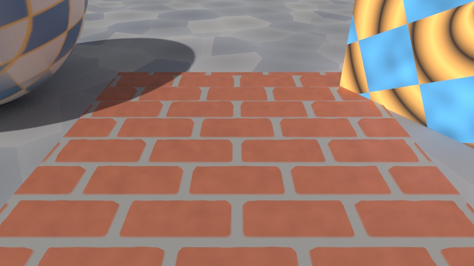

# Shader graph language



One scene, four graphs. The sphere maps a generated checker in object space with
triplanar projection, so the pattern turns with the sphere and has no seams. The
brick floor tile marches 32 parallax layers into a generated height field. The
cube combines polar bands, a rotated checker, a four-iteration noise loop and a
branch between them. The ground is cellular noise. The same graphs render in
[raster PBR](scene/graphlang-raster.jpg) and in the path tracer above (256
samples per pixel, four bounces). The scene source is
`Tests/FrostfieldTests/GraphLanguageCapture.swift`.

| Raster, flat UVs | Raster, parallax occlusion | Path traced, parallax occlusion |
| --- | --- | --- |
|  |  |  |

With parallax, the raised bricks hide the near half of each horizontal mortar
groove and show the face of the next brick, and both renderers agree.

## What the language adds

| Capability | Public API | Raster PBR | Path tracer | Other stages | Verified by |
| --- | --- | --- | --- | --- | --- |
| If / else-if / else that run only the chosen arm | `MaterialGraph.Node.branch`, `ShaderGraphBuilder.branch(_:then:else:)`, `branch(_:otherwise:)` | Yes | Yes | Vertex, post-process, compute | `ShaderControlFlowTests`, `ShaderGraphInputTests.controlFlowInRenderers` |
| Bounded loops with an index, an accumulator, break, continue and a dynamic count | `.loop`, `.loopIndex`, `.loopValue`, `loop(count:initial:_:)`, `loop(count:iterations:initial:_:)`, `loop(count:initial:until:)`, `ShaderLoopStep.skip` | Yes | Yes | All | Same |
| A budget of 65,536 loop iterations and parallax layers per evaluation, nested counts multiplied | `MaterialGraph.maximumTotalIterations`, `Failure.tooManyIterations` | Yes | Yes | All | `ShaderControlFlowTests.iterationBudget` |
| Exact switch and fragment discard | `` `switch` ``, `.switchSelect`, `discard(_:_:)` | Switch: all stages. Discard: surface | Discard clears the surface mask, so raster and path coverage reject the fragment | Switch: all. Discard is rejected in vertex, compute and post-process | `ShaderControlFlowTests.switchContinueAndDynamicCount`, `ShaderGraphRenderingTests.discardFragment` |
| Declared functions that take derivatives stay outside branch arms | `ShaderFunction` bodies that mention `dfdx`, `dfdy`, `fwidth`, `quad_` or `simd_`, directly or through another declared function | Yes | Yes | All | `ShaderControlFlowTests.functionPlacement` |
| Oscillators | `.oscillator`, `MaterialGraph.Oscillator`, `oscillator(_:_:)`, `ShaderValue.oscillated(_:)` | Yes | Yes | All | `ShaderPatternTests.oscillators` |
| Coordinate utilities | `.rotateUV`, `.spherizeUV`, `.polar`, `.checker` and builder methods of the same names | Yes | Yes | All | `ShaderPatternTests.coordinates` |
| Triplanar weights and sampling, one or three textures | `.triplanarWeights`, `.triplanarSample`, `triplanarWeights(normal:sharpness:)`, `triplanar(x:y:z:position:normal:sharpness:)`, `ShaderTexture.triplanar(position:normal:sharpness:)` | Yes | Yes | All | `ShaderPatternTests.triplanar`, `ShaderGraphViewTests.triplanarInRenderers` |
| Parallax occlusion mapping | `.parallaxOcclusion`, `ShaderTexture.parallaxOcclusion(_:view:depth:steps:)`, `tangentSpace(_:)` | Yes | Yes | All | `ShaderPatternTests.parallaxOcclusion`, `ShaderGraphViewTests.parallaxInRenderers`, capture above |
| Screen-space derivatives | `.derivative`, `MaterialGraph.Derivative`, `dFdx()`, `dFdy()`, `fwidth()` | Yes | Rejected | Post-process yes; vertex and compute rejected | `ShaderPatternTests.derivatives`, `ShaderGraphInputTests.screenSpace` |
| Bit operations and value hashing | `.bits`, `MaterialGraph.BitOperation`, `.hash`, `bits(_:_:)`, `hash()` | Yes | Yes | All | `ShaderPatternTests.bitsAndHashes`, `ShaderNoiseTests` |
| Dithering | `.interleavedGradientNoise`, `interleavedGradientNoise(_:)`, `dither(_:pixel:levels:)`, `bayerDither(_:pixel:levels:)` | Yes | Yes | All | `ShaderPatternTests.dithering`, `bayerDithering` |
| 3 × 3 and 4 × 4 matrices | `ValueType.matrix3`, `.matrix4`, `.matrix`, `.matrixMultiply`, `.matrixUnary`, `.matrixColumn`, `ShaderMatrixType`, `constant(_:)` and `uniform(_:_:)` for `simd_float3x3` and `simd_float4x4`, `ShaderUniforms.set(_:to:)`, `matrix3(named:)`, `matrix4(named:)`, `*`, `inverse()`, `transposed()`, `determinant()`, `column(_:)`, `upperLeft`, `transformPoint(_:)`, `transformDirection(_:)` | Yes | Yes | All | `ShaderPatternTests.matrices`, `matrixUniforms` |
| Signed 32-bit integers and bools | `ValueType.int`, `.bool`, `.bitcast`, `.countOneBits`, `.numericCast`, `bitcast()`, `countOneBits()`, `toInt()`, `toFloat()`, `ShaderUniforms.setInteger(_:_:)`, `setBoolean(_:_:)`, `integer(named:)`, `boolean(named:)` | The surface shader compiles; this lane did not read raster or path pixels | Not executed | Compute buffer kernel | `ShaderPatternTests.integersAndBools`, `SceneArchiveTests.integerUniforms` |
| Struct values | `ShaderStruct`, `ShaderGraphBuilder.defineStruct(_:_:)`, `make(_:_:)`, `ShaderStructValue.field`, `branch` for structs | The value can feed any stage that can run the graph | Same | Compute buffer kernel | `ShaderPatternTests.structs` |
| Graph clock | `Input.time`, `.deltaTime`, `.frame`, `ShaderFrame`, `ShaderUniforms.frame`, `setFrame(_:)`, `advanceFrame(by:)`, `frameRevision` | Yes | Yes | Vertex, post-process, texture and buffer compute, particles | `ShaderGraphInputTests.clock`, `.clockConsumers`, `.particleClock` |
| Camera | `Input.cameraPosition`, `.cameraNear`, `.cameraFar`, `.viewMatrix`, `.projectionMatrix`; `ShaderGraphCamera` and `GLTFScene.Camera.View.graphCamera` for clip-matrix encodes | Yes, every encode path | Planar matrices use the full image projection, including lens shift and orthographic scale. Panoramas support view and clip inputs. | Rejected | `ShaderGraphInputTests.cameraAndModel`, `ShaderGraphViewTests.graphCameras`, `.pathCameraProjection` |
| Model | `Input.modelMatrix`, `.normalMatrix` | Yes, the node matrix | Yes, except instanced nodes | Rejected | `ShaderGraphInputTests.cameraAndModel`, `ShaderGraphViewTests.modelMatrices` |
| Screen | `Input.screenUV`, `.viewportSize`, `.screenCoordinate`, `.screenSize`, `ShaderGraphBuilder.fragmentCoordinate` | Yes | Rejected | Post-process yes | `ShaderGraphInputTests.screenSpace`, `ShaderGraphViewTests.offsetViewport` |
| Tangent frame along +U and +V of UV0 | `Input.tangent`, `.bitangent`, `tangentSpace(_:)`; graph normal outputs use the same frame | Yes | Yes | Rejected | `ShaderGraphViewTests.tangentFrames` |
| CPU noise identical to the GPU nodes | `ShaderNoise.value`, `.gradient`, `.noise`, `.fractal`, `.cellular`, `.hash`, `.interleavedGradient` | n/a | n/a | n/a | `ShaderNoiseTests` |

Every node is checked on the GPU against a CPU reference or a closed form. The
language tests run graphs through `ShaderBufferKernel`, the production compute
hook, and the renderer tests read pixels from raster PBR and the path tracer.
Each new test was confirmed to fail when its feature was deliberately broken:
a flipped oscillator sign, no parallax refinement, unnormalized triplanar
weights, a swapped clock component, a swizzled raster camera, the path tracer's
screen-space check removed, the raster bitangent sign taken from tangent w, the
bitangent flipped in both renderers, the normal matrix transposed in both, raster
`screenUV` ignoring the viewport origin, `screenSize` reporting the viewport, the
graph camera ignored, the old triplanar formula, declared derivative functions
allowed into branch arms, the iteration budget removed or not multiplied through
nested loops, deformation and path accumulation reacting to every clock tick or to
none, a particle system left without live values, the parallax helper's early
return restored, and a matrix uniform's columns read one slot late.

## Measured results

Apple M4 Max, macOS 27.2, Xcode 27.2, Metal API Validation on except where noted.
Other test processes shared the GPU during every run; the timing rows report the
least disturbed run as well as the median.

| Check | Result |
| --- | --- |
| `ShaderNoise` against the GPU at 1,000 random points in ±60 plus lattice, boundary, negative-zero and clamped points: value, gradient, two fractal sums, cellular distance and identifier | Largest difference 1.19 × 10⁻⁷; every hash and cell identifier identical |
| Parallax on planar height fields at heights 1, 0.75, 0.5, 0.2 and 0 and seven view directions | Offset equals `−(v.xy / max(v.z, 0.05)) · depth · (1 − h)` within 10⁻⁶ UV |
| Parallax at a height step with 8 and 32 layers | Within one layer of the analytic wall depth; equal to a CPU march within 10⁻⁶ UV |
| Triplanar weights for 305 normals at sharpness 0, 1, 4 and 8.5 | Sum to 1 within 10⁻⁶; equal `|n|ᵏ / Σ|n|ᵏ` within 2 × 10⁻⁵ |
| Triplanar weights where every `|n|ᵏ` underflows in float: sharpness 200 and 1,000, normals of length 10⁻³, 10⁻²⁰ and 10⁻³⁰ | Equal the double-precision ratio within 2 × 10⁻⁵; the previous formula returned 1/3 each |
| Tangent frames on planes with derived tangents, authored w = −1 and w = +1, and mirrored U | Tangent, bitangent and `tangentSpace` equal (+U, +V, N) in both renderers within half-float tolerance; a graph normal leaning toward +V lit from below gives cos/π within 1 % in both |
| Parallax on a zero height field in raster PBR (pixel centers) and the path tracer (64 samples per pixel), at five pixels, for derived, w = −1 and w = +1 tangents | Offset times 4 equals `−4 (v.xy / v.z) · depth` in UV0 within 3 × 10⁻³ (raster) and 5 × 10⁻³ (path) |
| `modelMatrix` and `normalMatrix` under a rotation about (1, 1, 0.3) with scale (1.2, 0.9, 0.5) | Equal the `simd` model matrix and inverse transpose in both renderers; the transpose would differ by more than 0.2 |
| Offset viewport (origin 10, 6; size 40 × 52 in a 65 × 65 target) | `screenUV`, `fragmentCoordinate`, `viewportSize`, `screenCoordinate` and `screenSize` equal their closed forms at four pixels |
| Oscillators at 12 times from −1.3 to 17.125 | Square, triangle and sawtooth exact; sine within 10⁻⁵ of a double-precision reference |
| Raster against path tracing for clock, camera, view, projection, model, normal-matrix, loop, branch and noise outputs | Equal to the analytic or `ShaderNoise` value within 2 × 10⁻³ + 10⁻³ · |value| in RGBA16Float |
| Matrix uniforms, one float4 slot per column, against `simd` at four points including a direction with w = 0 | Compute readback within 10⁻⁵. A translated point's emission matches in raster and path, and a vertex offset matches, within the half-float and deformation thresholds. Reading each matrix4 column one slot late failed the generated-source check and all eight GPU comparisons. macOS passed the language, pattern, rendering and deformation suites together (38 tests) and `SceneArchiveTests` (12 tests). The iPad Pro (M5) simulator passed all five suites (50 tests) |
| Signed integers and bools | Bitcast round trip, population count, division of -7 by 2, and `toInt` truncation match on five floats. A bool uniform selects 0 then 1. Integer uniform 4, then 5, then -2 (whose bits are a float NaN) produces 11, 13 and -1 without a second pipeline. A float-only uniform still reads `frostfield_graph_uniform(resources, 0u).x`. Sine of an integer, an integer scaled by a float, and addition of a bool are rejected. An archive round-trips -2 and true. macOS and the iPad Pro (M5) simulator each passed the language and pattern suites (25 tests). macOS also passed the pattern and archive suites together (25 tests); the iPad simulator passed that pair before the float-only rejection was added |
| Switch, continue and a dynamic loop count | Exact on nine counts, including a count of 2.9 truncating to two iterations and a count above the maximum clamping to eight. A nonfinite count leaves the accumulator at its initial value. The private node of the matching switch arm is generated after that arm's comparison. Discard keeps the low-U half and clears the high-U half in raster and path tracing. macOS and the iPad Pro (M5) simulator each passed the control-flow, rendering and input suites (21 tests) |
| Nested structs | A `Point` inside a `Sample` scales x by the struct's scale and a branch chooses the other struct's y and scale. Compute readback is exact for (1, 4), (0, 9) and (0.2, −3). A missing field, a field read as the wrong type, and a branch of two different structs are rejected. JSON round-trips the graph. An integer uniform may default to −2. macOS and the iPad Pro (M5) simulator each passed the language and pattern suites (26 tests) |

## Semantics

**Control flow.** `ShaderProgram` places each node in the deepest scope that
contains all its uses: the function body, one arm of a branch, or a loop body.
A node that only one arm reads is generated inside that arm. A node that reads a
loop's index or value belongs to that loop's body; everything else is evaluated
once, before the loop. Texture samples, derivatives, triplanar and parallax
nodes, and loops that contain them, stay outside branch arms so their implicit
derivatives are defined, and they may not depend on a loop that can exit early.
Calls to declared functions whose bodies mention `dfdx`, `dfdy`, `fwidth`,
`quad_` or `simd_`, directly or by calling another such function, are treated
like samples. The check is textual and errs toward keeping a call outside an
arm. Validation rejects a loop value used outside its loop, loop counts outside
1–1,024, nesting deeper than 16, divergent samples, and evaluations that would
run more than 65,536 loop iterations and parallax layers (each loop's count times
the counts of the loops around it, each parallax node's layers plus one times the
same factor), each with the node number. Generated Metal keeps one statement per
node with its `// node N` marker.
This is the body `SurfaceShaderGraph.metalFunction(named:)` emits for a roughness
that mixes a four-octave noise loop with a branch:

```swift
let sum = s.loop(count: 4, initial: s.constant(Float(0))) { i, total in
    total + s.noise(s.worldPosition * (i + 1)) * 0.25
}
let chosen = s.branch(s.roughness.greaterThan(s.constant(Float(0.5)))) {
    s.fractalNoise(s.worldPosition * 3, octaves: 3).named("detail")
} else: { s.roughness }
return .init(roughness: sum.mix(chosen, by: s.metallic))
```

```metal
    float n1 = 0.0f; // node 1
    float3 n5 = input.worldPosition; // node 5
    float n6 = 1.0f; // node 6
    float n10 = 0.25f; // node 10
    float n2 = n1; // node 2 loop 4
    for (int n2_i = 0; n2_i < 4; ++n2_i) {
        float n4 = n2; // node 4
        float n3 = float(n2_i); // node 3
        float n7 = n3 + n6; // node 7
        float3 n8 = n5 * n7; // node 8
        float n9 = frostfield_graph_gradient_noise(n8); // node 9
        float n11 = n9 * n10; // node 11
        float n12 = n4 + n11; // node 12
        n2 = n12;
    }
    float n0 = input.roughness; // node 0
    float n13 = 0.5f; // node 13
    float n14 = select(float(0), float(1), n0 > n13); // node 14
    float n18; // node 18 branch
    if (n14 > 0.5f) {
        float n15 = 3.0f; // node 15
        float3 n16 = n5 * n15; // node 16
        float n17 = frostfield_graph_fbm(n16, 3, 2.0f, 0.5f, 1u); // node 17 detail
        n18 = n17;
    } else {
        n18 = n0;
    }
```

**Clock.** `time`, `deltaTime` and `frame` read one float4 that every renderer
binds after the graph's declared uniforms. `ShaderUniforms.setFrame(_:)` and
`advanceFrame(by:)` change it and advance `frameRevision`; `revision` counts
changes to declared values only. Vertex deformation runs again on a clock change
only when the vertex offset reads the clock, and the path tracer restarts
accumulation only when a traced surface graph that shares the block reads it. A
PBR material or `ShaderParticleSystem` whose graph reads the clock creates live
values even when the graph declares no uniforms and none are passed in.

**Camera and model.** Raster PBR receives the inputs per draw at fragment buffer
23. `viewMatrix` is the inverse camera transform; `projectionMatrix` is
`PerspectiveCamera.projection(aspectRatio:)` for the attachment. `modelMatrix`
is the node's world matrix; for an `InstanceSet` it excludes the per-instance
transform, as Three.js `modelWorldMatrix` does. The path tracer stores the
tracing camera in the first ten graph uniform slots and reads the model matrix
from the hit instance; because each traced instance carries its own matrix, it
rejects graphs that read `modelMatrix` or `normalMatrix` on instanced nodes.
`SceneGraph.encode(...clipFromWorld:cameraPosition:...graphCamera:)` takes the
separate view and projection matrices and clip distances as a
`ShaderGraphCamera`, whose projection times view must equal the clip matrix to
within 10⁻⁴ of its largest element. glTF camera views carry one
(`GLTFScene.Camera.View.graphCamera`, with an infinite far distance for an
infinite projection), and reversed-depth or stereo callers build their own. A
graph that reads the view or projection matrix or the clip distances in a
clip-matrix encode without a graph camera, or with one that disagrees, fails with
`MeshRenderer.Failure.graphCameraInputs`. Vertex deformation runs once per mesh
rather than per draw, so it has no camera or model inputs.

**Tangent frame.** `tangent` points along increasing U of UV0 and `bitangent`
along increasing V, in raster PBR and the path tracer alike. Raster takes the
tangent direction from the vertex tangent when one is authored, but the sign of
the bitangent always from the UV derivatives, because authored tangent w follows
different conventions: glTF exporters write w = +1 for the usual mapping where V
runs down the image, where a frame aligned with dP/dv has w = −1. `tangentSpace(_:)`
and graph normal outputs use this frame, so parallax marches the same way on
either kind of mesh.

**Screen space.** `screenUV`, `viewportSize` and `fragmentCoordinate` are
relative to the viewport (Three.js `viewportUV`, `viewportSize`,
`viewportCoordinate`); `screenCoordinate` and `screenSize` cover the whole render
target (Three.js `screenCoordinate` and `screenSize`, with TSL's `screenUV` being
`screenCoordinate / screenSize`). Post-processing covers its whole output, so the
two sets agree there. These inputs and derivatives exist only where a rasterizer
shades a pixel grid: raster surfaces and post-processing. A path at its second
bounce has no pixel, so `PathTracingScene` rejects such graphs with
`Failure.unsupported`, naming the node. Compute and vertex stages reject them
with `MaterialGraph.Failure.unavailable`.

**Parallax.** The generated helper marches a fixed number of layers and has a
single return at its end. A view at or below the surface, a nonpositive or
nonfinite depth, or nonfinite coordinates march with no shift and return the
coordinates unchanged, so every pixel of a 2 × 2 quad takes every sample and
implicit mip selection stays defined.

**CPU noise.** The GPU noise helpers write every multiply-add as `fma`, and
`ShaderNoise` repeats each operation with `addingProduct`, so the result does not
depend on compiler contraction. Use it to place or scatter on the CPU where the
GPU shades with the same pattern.

## Compared with Three.js TSL

| Three.js | Frostfield | Status |
| --- | --- | --- |
| `If`, `ElseIf`, `Else`, `select` | `branch`, `branch(_:otherwise:)`, `select` | Match. Arms run only when taken, as in TSL; unlike TSL, samples and derivatives are moved out of arms automatically and divergent ones are rejected |
| `Switch` | `` `switch` `` | Match. Exact equality, one through 16 arms, and only the chosen arm's private nodes run |
| `Loop` with `Break` and `Continue` | `loop(count:initial:_:)`, `loop(count:iterations:initial:_:)`, `loop(count:initial:until:)`, `ShaderLoopStep.skip` | Match within the iteration budget. A dynamic count truncates toward zero and clamps to 0...the declared maximum; a nonfinite count runs none. Continue keeps the accumulator and skips nodes only the update reads |
| `Discard` | `discard(_:_:)` | Surface stage. Sets the coverage mask false, which raster `discard_fragment` and path-traced hit acceptance both honor |
| `oscSine`, `oscSquare`, `oscTriangle`, `oscSawtooth` | `oscillator(_:_:)` | Match; any scalar or vector |
| `rotateUV`, `spherizeUV`, `checker`, `remap` | Same names | Match; `checker(uv)` in TSL is `checker(uv * 2)` here |
| Polar coordinates (`polarCoordinates` in other node systems) | `polar` | Match |
| `triplanarTexture`, `triplanarTextures` | `ShaderTexture.triplanar`, `triplanar(x:y:z:...)`, `triplanarWeights` | One or three textures, adjustable weights and stable normalization at high sharpness |
| `parallaxUV` | `ShaderTexture.parallaxOcclusion` | Layered occlusion mapping with intersection refinement |
| `dFdx`, `dFdy`, `fwidth` | Same | Match in raster; the path tracer rejects them by name |
| `time`, `deltaTime`, `frameId` | `time`, `deltaTime`, `frame` | Match; driven per graph by `ShaderUniforms` rather than a renderer clock |
| `viewportUV`, `viewportSize`, `viewportCoordinate` | `screenUV`, `viewportSize`, `fragmentCoordinate` | Match in raster and post-processing; the names differ |
| `screenUV`, `screenSize`, `screenCoordinate` | `screenCoordinate / screenSize`, `screenSize`, `screenCoordinate` | Match in raster and post-processing; Frostfield's `screenUV` is the viewport-relative one |
| `cameraPosition`, `cameraNear`, `cameraFar`, `cameraViewMatrix`, `cameraProjectionMatrix` | Same meanings | Raster default, glTF, and explicit camera views. Path-traced perspective and orthographic cameras provide projection inputs, including for render tiles. |
| `modelWorldMatrix`, `modelNormalMatrix` | `modelMatrix`, `normalMatrix` | Match; path tracer except instanced nodes |
| `mat2`, `mat3`, `mat4`, matrix operations and `uniform(mat3)` / `uniform(mat4)` | `matrix3`, `matrix4` nodes and `uniform(_:simd_float3x3)`, `uniform(_:simd_float4x4)` | Partial: 3 × 3 and 4 × 4 with multiply, transpose, inverse, determinant, columns and live uniforms; no `mat2`. Matrix uniforms are not animation tracks |
| `int`, `bool`, `bitcast`, `countOneBits`, `floatBitsToInt` | `Int32`, `Bool`, `bitcast()`, `countOneBits()`, `toInt()`, `toFloat()`, `setInteger(_:_:)`, `setBoolean(_:_:)` | Partial: signed 32-bit values and bools, including uniforms edited without a new pipeline. No `uint` or integer vectors |
| `struct` | `ShaderStruct`, `defineStruct(_:_:)`, `make(_:_:)`, `ShaderStructValue.field` | Partial: nested structs, field reads, and branches of the same struct. A struct cannot be a uniform or a declared-function type |
| `hash`, bitwise operators | `hash`, `bits` | Partial: 24-bit unsigned integers carried in floats. Signed integers use the operations above |
| `interleavedGradientNoise`, `bayerDither` | `interleavedGradientNoise`, `dither`, `bayerDither` | The ordered RGB offset uses the r187 4×4 phase with caller pixel coordinates and a default of 32 levels. Metal readback matches all phases across 144 samples, including negative coordinates and a live level count. [Three.js r187 Bayer shader](https://github.com/mrdoob/three.js/blob/r187/examples/jsm/tsl/math/Bayer.js) |
| `snoise`, `curlNoise`, `voronoi3d` | `simplexNoise`, `curlNoise`, `animatedVoronoi` | Three-dimensional simplex and curl, plus animated squared cell distance in two or three dimensions. [Procedural pattern evidence](shader-procedural-patterns.md) |
| `mx_noise_float` and friends; `ImprovedNoise`, `SimplexNoise` addons | Lattice, fractal and cellular nodes with `ShaderNoise` | Frostfield's CPU and GPU functions agree within 1.2 × 10⁻⁷. MaterialX, Perlin and simplex algorithms remain separate. |
| `attribute()`, `varying()`, custom vertex attributes | Not provided | Missing |
| `instanceIndex` | Not provided | Missing |
| `materialReference`, `reference` | Declared uniforms by name | Partial |
| Node labels | `named(_:)`, `labels` | Match |

## Limits

- Custom vertex attributes and `instanceIndex` remain open. The raster and
  path-tracing stages use fixed vertex layouts.
- A loop declares a maximum of 1,024 iterations. A dynamic count truncates
  toward zero and clamps to that maximum, and the budget still uses the maximum.
  Continue keeps the accumulator. One evaluation may run at most 65,536 loop
  iterations and parallax layers, counted at their worst case even inside
  branch arms. Branches and switch arms cannot contain texture samples,
  derivatives, or calls to declared functions that mention derivative or lane
  functions; those always run. Discard is a surface-stage coverage decision.
- Signed 32-bit integers and bools are values. Integer division truncates toward
  zero and a zero divisor yields zero. `toInt` truncates toward zero and maps a
  nonfinite float to zero. `countOneBits` counts the float's IEEE bits or the
  integer's two's-complement bits. A bool branch reads the bool; a float branch
  still tests above 0.5. An integer uniform stores that bit pattern in one float4
  slot, so values such as -2 are NaN if read as float. JSON stores the declaration
  as `integerValue`, and an archive stores the live integers in `integerValues`,
  because those bits do not survive a JSON float. An integer declaration may use
  those bits as its default. Float scalar uniforms still occupy one slot and read
  `.x` with no bitcast. There is no unsigned integer or integer vector. The float
  `bits` path still clamps to 24-bit unsigned values. `AnimationTrack` rejects an
  integer, boolean, matrix, or struct uniform (`unknownUniform`).
- A struct is a named list of fields. A field is a scalar, vector, matrix, int,
  bool, or an earlier struct. `make` builds one and `field` reads it back. A
  branch may choose between two values of the same struct. A graph may declare
  16 structs of 16 fields. Structs are not uniforms and cannot be the type of a
  declared Metal function. Float graphs that declare none emit no struct type.
- A matrix uniform is one float4 slot per column, column-major, then any later
  uniforms. Scalar and vector uniforms keep one slot each, so a graph that
  declares none of these matrices binds the same buffer as before. There is no
  2 × 2 matrix type. `AnimationTrack` rejects a matrix uniform
  (`unknownUniform`); set it on `ShaderUniforms` instead.
- The clock reaches graphs as 32-bit floats. After t seconds the oscillator
  phase carries about t × 2⁻²² radians of rounding.
- Parallax reads the red channel and clamps the view's z to 0.05.
  Self-shadowing and silhouette clipping remain open.
- The graph tangent frame ignores the sign of authored tangent w. Authored
  normal maps outside graphs are not part of this lane: raster PBR takes their
  bitangent sign from tangent w while the path tracer derives it from UVs, so
  meshes with w = +1 tangents (the glTF convention for the usual mapping) shade
  authored normal maps differently in the two renderers. That belongs to the
  material lane.
- Clip-matrix encodes accept a `ShaderGraphCamera` whose projection times view
  equals the clip matrix within 10⁻⁴ of its largest element; looser
  combinations are rejected.
- `MaterialGraph`, the original unlit graph, still reads only UV0, the normal,
  world position and parameters.
- The matrix-uniform suites passed on the iPad Pro (M5) simulator, as did the
  integer and bool pattern and language suites. Physical iPhone, iPad and Vision
  Pro runs have not been made. The lane adds no new dispatches or texture views.

## Vector directions

`ShaderValue.refract(_:eta:)` computes a transmitted direction for unit
vectors and a constant or graph-controlled index ratio. Total internal
reflection returns zero. `faceForward(incident:referenceNormal:)` uses
the sign of the incident/reference dot product and flips at zero.
Reflection accepts two-, three-, or four-component values and normalizes
its normal. The two-component cross product returns the signed perpendicular
component. Refraction, face-forward and the two-component cross product
reuse existing graph nodes and archive representation.

RGBA32Float Metal readbacks match the expected transmission, zero vector
above the critical angle, signed cross product, normalized reflection and
face-forward at zero. All 72 focused tests passed on macOS and iPhone 18 Pro
Simulator with Metal API Validation. Xcode 27.2 `xcodebuild` ran after the
bridge timed out resolving the package destination.
[Three.js r187 vector math nodes](https://github.com/mrdoob/three.js/blob/r187/src/nodes/math/MathNode.js) · [Apple refraction semantics](https://developer.apple.com/documentation/shadergraph/geometric/refract-%28realitykit%29)
