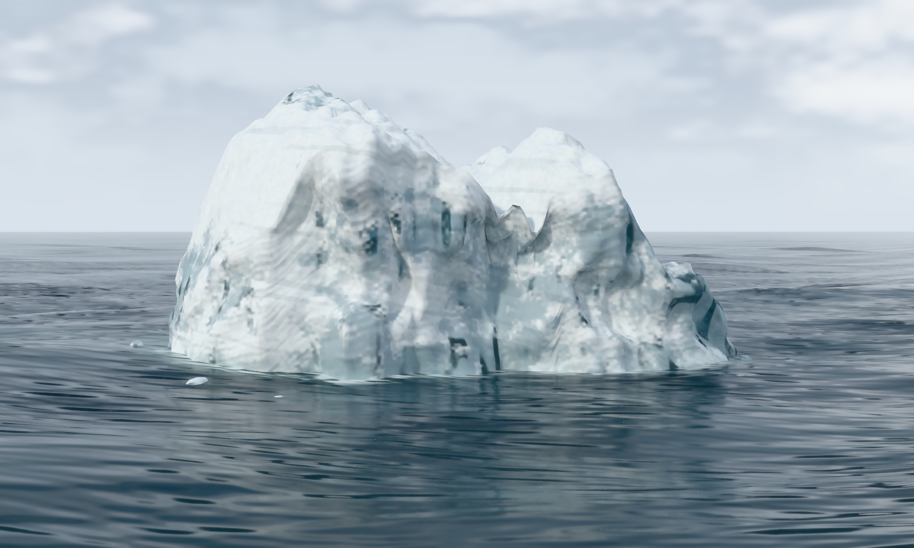

# Procedural iceberg in open ocean



FrostfieldLab generates the closed iceberg mesh, floating fragments, wave
geometry, and cloudy sky in Swift and Metal. Uneven calved slabs and a diagonal
fracture shape the silhouette. The material varies frost, fine surface relief,
and transmission across the mesh. Frost uses rough surface scattering. Clearer
fractures refract light and absorb color along its path through the closed mesh.
Broken foam follows the intersection of the iceberg with the displaced ocean.
[Scene](../../Examples/FrostfieldLab/FrostfieldLab/LabIcebergScene.swift) ·
[Ice geometry](../../Examples/FrostfieldLab/FrostfieldLab/LabIcebergGeometry.swift) ·
[Ocean](../../Examples/FrostfieldLab/FrostfieldLab/LabIcebergOcean.swift) ·
[First render](scene/iceberg-ocean.jpg)

The revised still uses 512 samples per pixel at 1920 × 1152, up to seven ray
bounces, and two guided denoising passes. The native Release Lab built and
rendered on an M4 Max Mac Studio running macOS 27.2 with Metal API Validation.
A mesh check verified 50,760 nondegenerate ice triangles and two oppositely
wound faces per welded edge. The revision changes the Lab scene. The previous
engine verification passed 184 tests in 53 suites, including the GPU
transmission-mask test. The Xcode bridge's configured build volume was full,
so the build used `xcodebuild` with DerivedData on the internal drive.

Launch FrostfieldLab with `--iceberg` to orbit the scene. To render the still
from the Mac Release app directory, run the following command.

```sh
FrostfieldLab.app/Contents/MacOS/FrostfieldLab --capture-iceberg /tmp/iceberg.png 512
```
