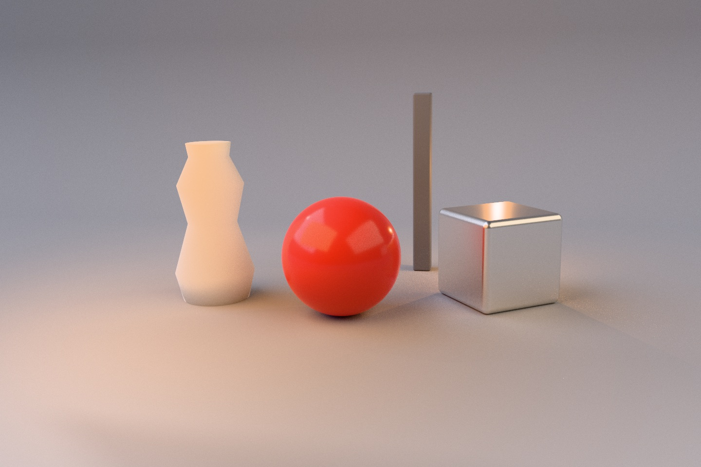

# Light rigs in both renderers



The Light Lab lights a studio set with one `LightRig`: a softbox, a spotlight,
a bulb, a sun, and an HDR sky. Each light has power or illuminance, a size,
a color temperature, an aim from azimuth and elevation, and a shadow switch.
The same rig produces raster light nodes and the path tracer's lighting.
[Scene source](../../Examples/FrostfieldLab/FrostfieldLab/LabLightLab.swift)

| Rig | Raster | Path traced (512 samples per pixel) |
| --- | --- | --- |
| Default | [raster](scene/light-lab-raster.jpg) | [path](scene/light-lab-path.jpg) |
| Edited: 3,000 K softbox at 2.2× size, spot off, 6° sun, sky turned 120° | — | image above |

The raster view adds image-based sky light without occlusion or bounce light,
so it looks cooler and flatter than the path-traced image. Both use the same
light positions, sizes, colors, and power.

## Units and conversions

| Kind | Emission | Raster | Path tracer |
| --- | --- | --- | --- |
| Rectangle | power Φ or luminance L, `L = Φ / (π·w·h)` | `PunctualLight.Kind.rectangle`: exact Lambertian irradiance with horizon clipping, representative-point specular, shadows from the center | `PathTracer.AreaLight` with matching half axes |
| Spot | power Φ or intensity I, `I = Φ / Ω`, `Ω = 2π[(1 − cos i) + (cos i − cos o)/3]` | spot light with smooth squared cone, shadows | `PathTracer.AnalyticLight`, same falloff |
| Point | power Φ or intensity I, `I = Φ / 4π` | point light, six-face shadows | analytic point light |
| Directional | illuminance in lux, angular diameter | `DirectionalShadowMap`, live `update(...)` | analytic sun with a sampled disk |
| Sky | intensity and yaw | `SceneGraph.environmentIntensity`, `environmentRotation`, `EnvironmentBackground` | `PathTracer.Environment.map` with importance sampling |

`LightRigTests` checks the closed-form spot solid angle against a numerical
integral of the shading falloff, the rectangle and point conversions, color
temperature, aim, and validation. A cross-renderer test lights one diffuse
plane with the same rig: a spot matches within 1% and a rectangle within 4%
after 1,024 path samples per pixel.

Raster shadows for point, spot, and rectangle lights use `PunctualShadowMaps`
with PCF and normal-offset bias. GPU readback tests cover occluders on several
cube faces, grazing receivers without acne, capacity overflow, alpha-masked and
skinned casters, the analytic rectangle form factor, horizon clipping, and
one-sided emission. The path tracer samples HDR environment maps by luminance
with multiple importance sampling. Its visible map matches raster
`EnvironmentBackground` within 0.03 per pixel, and a uniform map converges to
the constant-environment result within 1%.

## Edit behavior

| Change | Raster | Path tracer |
| --- | --- | --- |
| Light power, size, color, aim, shadows, sky | Next frame; no preparation | New `Lighting` value; history raises `.lightingChanged`, accumulation restarts, the scene and pipelines are reused |
| Shader uniforms | Next frame | `.surfaceUniformsChanged`, accumulation restarts |
| Geometry or deformation | Next frame | New `PathTracingScene`; cached shader libraries are reused |
| Display exposure | `HDRDisplay` only | `HDRDisplay` only; accumulated radiance is kept |

| Runtime | Observed |
| --- | --- |
| M4 Max Mac Studio, macOS 27.2 | Raster and path captures with Metal API Validation. |
| iPhone 18 Pro Simulator, iOS 27.2 | [Live controls](scene/light-lab-iphone.jpg) with Metal API Validation. |
| Apple Vision Pro Simulator, visionOS 27.2 | [Windowed controls](scene/light-lab-vision.jpg) with Metal API Validation. |

```sh
FrostfieldLab.app/Contents/MacOS/FrostfieldLab --capture-light-lab /tmp/path.png 1440 960 --set scene.path=1 --set scene.samples=512
```

Physical iPhone, iPad, and Vision Pro performance remains unmeasured.
