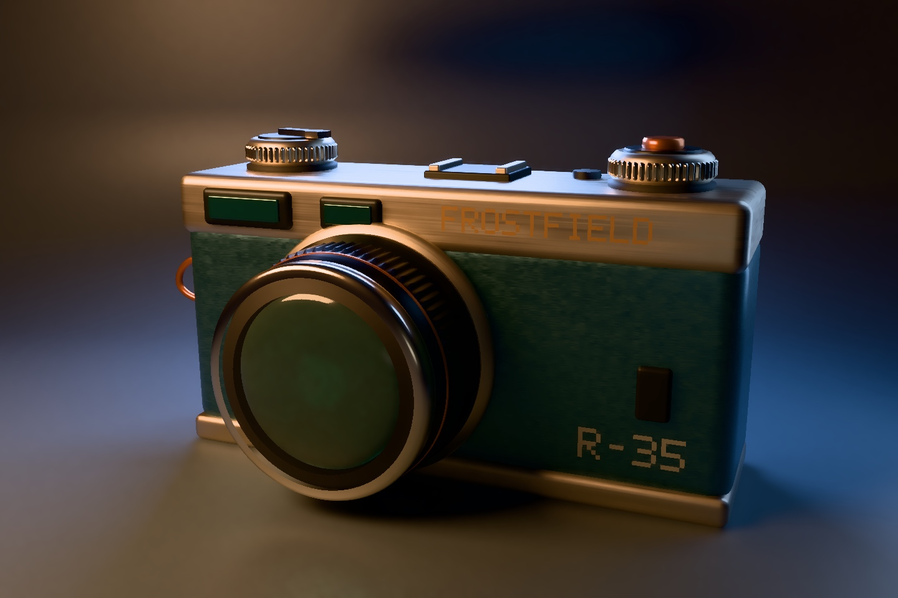

# Lighting and shader authoring

The studio pairs an editable path tracing light rig with a material generated
by `SurfaceShaderGraph`. The graph uses UV, world position, and procedural
noise to set the rangefinder body's color and roughness. The compiled Metal
function runs at surface hits and the area lights shape the highlights and
shadows. [Finish graph source](../../Examples/FrostfieldLab/FrostfieldLab/LabProceduralCamera.swift)



The [default rig](scene/light-shader-neutral.jpg) and the [edited rig](scene/light-shader-split.jpg)
use the same material, geometry, camera, and 256 samples per pixel at 1440 × 960.
The edited rig changes the panel power, area, angle, tint, and display exposure.
The [raster capture](scene/light-shader-raster.jpg) uses the same graph through
the raster studio's lighting and tone-mapping path.

Launch with `--path-light-controls` and choose Key, Fill, Rim, or Front.
Power sets output and zero turns the emitter off. Size changes panel area
and shadow softness while preserving total power. Angle moves the panel
around its aim point. Tint changes the color balance. Exposure adjusts the
display without discarding accumulated radiance. The preview settles at
32 samples per pixel. The panel's edits are session-local.

| Runtime | Observed |
| --- | --- |
| M4 Max Mac Studio, macOS 27.2 | Raster and path captures with Metal API Validation. |
| iPhone 18 Pro Simulator, iOS 27.2 | [Default controls](scene/light-shader-phone-default.jpg) and [higher key power](scene/light-shader-phone-power.jpg). A native drag changed Power from 1.00 to 2.18. Reset restored the original scene pixels after sampling settled. |
| iPad Pro 13-inch (M5) Simulator, iPadOS 27.2 | [Studio controls](scene/light-shader-ipad.jpg) with Metal API Validation. |
| Apple Vision Pro Simulator, visionOS 27.2 | [Windowed studio controls](scene/light-shader-vision.jpg) with Metal API Validation. |

The Mac suite passed 182 tests in 53 suites with Metal API Validation. A GPU
test rendered two distinct generated graphs through both renderers and
verified the same pixel values. Additional tests verified light-rig changes
and stale history rejection, preserved authored alpha, and directional
shadows on generated materials. Release builds passed for native macOS,
iOS and visionOS simulators, and unsigned iOS and visionOS device SDKs.
Xcode 27.2 (27B52). The Xcode bridge pointed DerivedData at a full external
volume, so builds and tests used `xcodebuild` with internal output paths.

```sh
FrostfieldLab.app/Contents/MacOS/FrostfieldLab --capture-path-traced-camera /tmp/default.png 256 --shader-finish
FrostfieldLab.app/Contents/MacOS/FrostfieldLab --capture-path-traced-camera /tmp/split.png 256 --shader-finish --path-look-split
FrostfieldLab.app/Contents/MacOS/FrostfieldLab --capture-procedural-camera /tmp/raster.png --shader-finish
```

Pass a graph to `PhysicallyBasedMaterial(surfaceGraph:)`. Outputs can set base
color, metallic, roughness, emission, and a transmission mask independently.
The optional mask scales authored transmission by a scalar clamped to 0–1.
Inputs include UV0,
world position, shading normal, and four floats from `SceneNode.materialParameters`.
Raster reads those values on every draw. Path tracing captures them in the
prepared scene. `metalFunction(named:)` exposes the emitted source.

```swift
let finish = try SurfaceShaderGraph(nodes: [
    .color(SIMD3(0.025, 0.08, 0.12)),
    .color(SIMD3(0.10, 0.24, 0.30)),
    .parameter(.x),
    .mix(0, 1, factor: 2),
    .scalar(0.38),
], outputs: .init(baseColor: 3, roughness: 4))
let material = try PhysicallyBasedMaterial(metallic: 0.75, surfaceGraph: finish)
let metal = try finish.metalFunction(named: "studio_finish")
```

The path tracer accepts up to 16 rectangular emitters and constant world
radiance. Pass a new `PathTracer.Lighting` to `encode` with nil history to
relight the same scene and accumulation buffers. The scene snapshot supports
up to 16 distinct surface graphs. Physical mobile and headset performance
remains open.
