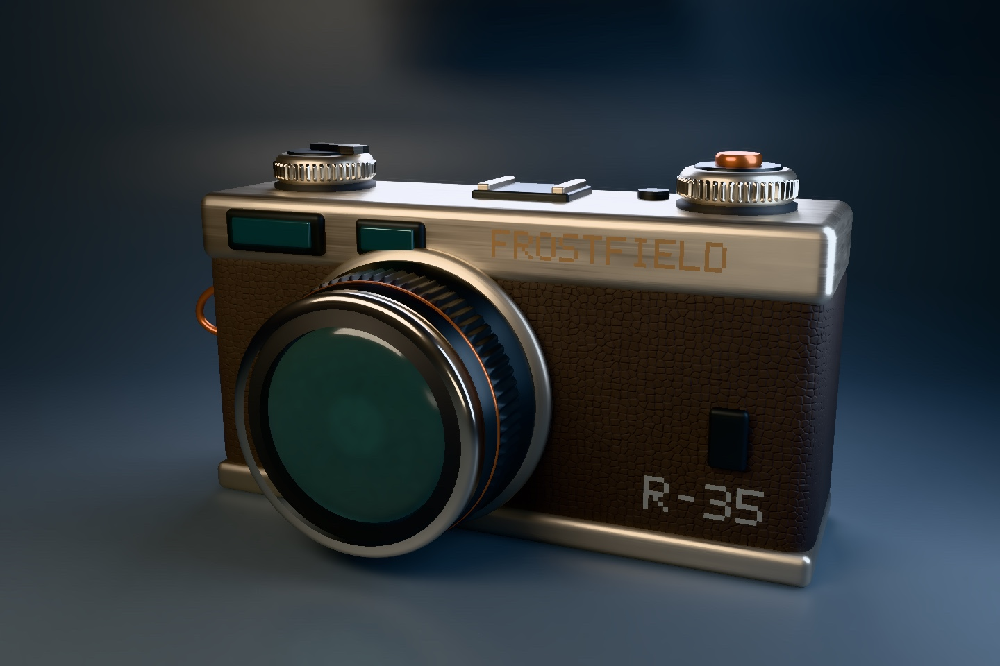

# Metal path tracing

The Swift-built rangefinder renders under four rectangular studio lights.
The path tracer follows camera, reflected, transmitted, and shadow rays
through the scene. Light bounces between surfaces, the optics use actual
dielectric boundaries, and the camera samples a finite aperture. An optional
filter uses first-hit normal, distance, albedo, and roughness to reduce noise.
[Scene source](../../Examples/FrostfieldLab/FrostfieldLab/LabPathTracingFixture.swift)



The Mac front view uses 512 samples per pixel and a seven-bounce budget.
The [lens close-up](scene/path-tracing-detail.jpg) uses 256 samples per pixel.
The [raster studio view](scene/path-tracing-raster.jpg) uses the same model
with its original HDR environment and directional light setup.

The lighting room fixes the scene, exposure, random seed, and 128 samples
per pixel. The [one-bounce image](scene/path-tracing-direct-room.jpg) shows
the direct emitter. The [seven-bounce image](scene/path-tracing-light-room.jpg)
shows the colored walls in the sphere, plus their light on the neutral box
and ceiling. A patch of the box at x 545–599 and y 680–769 averaged sRGB
code values (0, 0, 0) in the first image and (34, 36, 18) in the second.
This is a display-image comparison, measured in the original 1440 × 960 PNGs.

| Runtime | Observed |
| --- | --- |
| M4 Max Mac Studio, macOS 27.2 | Native HDR render and tone-mapped captures with Metal API Validation. |
| iPhone 18 Pro Simulator, iOS 27.2 | [Initial](scene/path-tracing-iphone-simulator.jpg) and [orbited](scene/path-tracing-iphone-rotated.jpg) previews with Metal API Validation. A pan restarted sampling, and the new view settled to identical idle captures. |
| iPad Pro 13-inch (M5) Simulator, iPadOS 27.2 | [Progressive preview](scene/path-tracing-ipad-simulator.jpg) at a 480 × 640 drawable. Two settled captures were identical. |
| Apple Vision Pro Simulator, visionOS 27.2 | [Windowed preview](scene/path-tracing-vision-simulator.jpg) at a 640 × 456 drawable. Two settled captures were identical. |

Release builds passed for native macOS, the iOS and visionOS simulators, and
the unsigned iOS and visionOS device SDKs. The Mac suite passed 174 tests in
51 suites with Metal API Validation, including a two-mirror path to an
off-camera emitter, split-sample accumulation and history ownership, scene
texture baking, and denoising across material edges. Xcode 27.2 (27B52).
The Xcode bridge's DerivedData path was on the full external drive. Builds
and tests used `xcodebuild` with internal output paths.

The preview accumulates up to 32 samples per pixel on demand. Orbiting,
zooming, or changing drawable dimensions restarts it. The still capture uses
the same tracer with more samples at 1440 × 960.

```sh
FrostfieldLab.app/Contents/MacOS/FrostfieldLab --capture-path-traced-camera /tmp/rangefinder.png 512
FrostfieldLab.app/Contents/MacOS/FrostfieldLab --capture-path-traced-camera /tmp/lighting-room.png 128 --path-light-room
FrostfieldLab.app/Contents/MacOS/FrostfieldLab --capture-path-traced-camera /tmp/lighting-direct.png 128 --path-light-room --path-direct
```

For another scene, prepare `PathTracingScene(queue:graph:)`, supply rectangular
emitters to `PathTracer`, and create an accumulation at the output size. Use
the returned history after each successful command buffer. Pass nil to reset
for a new camera. `PathTraceDenoiser` filters the optional guide outputs, and
`HDRDisplay` presents the linear color. For current mesh and material inputs,
see [scene preparation](../../Sources/Frostfield/PathTracingScene.swift).
[Full-resolution textures and acceleration evidence](pathscale.md)

The backend supports static metallic-roughness PBR geometry, masked opacity,
stochastic blended coverage, raster's written material alpha, described texture
sampling, and scalar clearcoat and optical properties. It uses its own emitters
and constant environment and derives occlusion from geometry. Animated skinning,
custom raster shaders, samplers without a `TextureSampling` description, and
caustic-specific sampling are outside this backend's current coverage. Physical
mobile and headset performance remains open.
