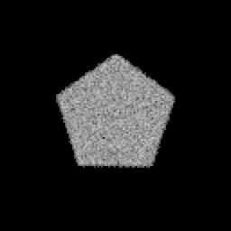
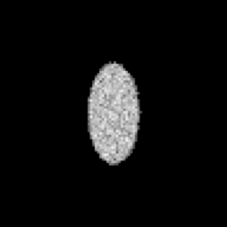
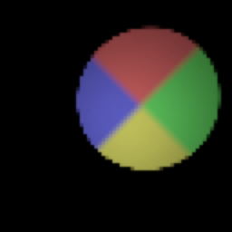
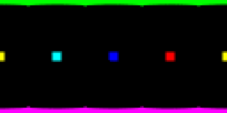
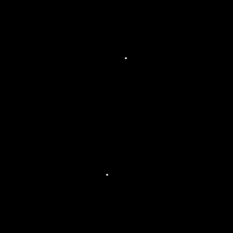
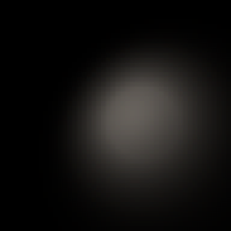
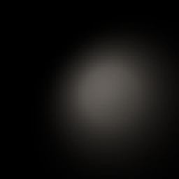

# Physical camera, projections, light profiles and exposure

| Pentagonal bokeh, path traced | 2× anamorphic bokeh | Spot cookie, raster | Spot cookie, path traced |
| --- | --- | --- | --- |
|  |  |  |  |

| Equirectangular axis markers | ODS, left eye over right eye | IES spot, raster | IES spot, path traced |
| --- | --- | --- | --- |
|  |  |  |  |

The images come from the test suites below, written when `FROSTFIELD_TEST_IMAGES`
names a directory, then enlarged. The equirectangular image shows the −Z marker
(blue) at the center, +X (red) a quarter width to its right, −X (cyan) a quarter
width to its left, +Z (yellow) on both seams, +Y (green) along the top row and −Y
(magenta) along the bottom row.

## Capabilities

| Capability | Public API | Raster | Path tracer | Verified by |
| --- | --- | --- | --- | --- |
| Lens and sensor: focal length (mm), sensor size (mm, full frame 36 × 24 by default), sensor fit, f-number, focus distance, clip planes | `PhysicalLens`, `PhysicalCamera`, `verticalFieldOfView(aspectRatio:)`, `horizontalFieldOfView(aspectRatio:)`, `filmSize(aspectRatio:)`, `PhysicalCamera.focalLength(verticalFieldOfView:filmHeight:)`, `perspectiveCamera(aspectRatio:)` | `perspectiveCamera(aspectRatio:)` | `pathCameraModel(aspectRatio:)` | `PhysicalCameraTests` |
| Thin-lens depth of field with one circle of confusion `c = f² |d − s| / (N d (s − f))` | `circleOfConfusionDiameter(distance:)`, `circleOfConfusionRadius(distance:imageHeight:aspectRatio:)`, `depthOfFieldSettings(aspectRatio:maximumRadius:)`, `pathApertureRadius` | `DepthOfField` disk gather with those settings | lens of radius `f/(2N) × s/(s − f)` | `PhysicalCameraRenderTests` |
| Polygonal aperture (3–16 blades), rotation, anamorphic ratio | `PhysicalLens.apertureBlades`, `apertureRotation`, `anamorphicRatio`; `PathTracer.CameraModel.Lens` | disk only | uniform sampling of the regular polygon, scaled per axis | `PhysicalCameraRenderTests` |
| Photometric exposure: EV100 from f-number, shutter time and ISO, exposure compensation, reflected and incident meters, two calibrations | `ev100`, `PhysicalCamera.ev100(fNumber:shutterTime:iso:)`, `ev100(luminance:)`, `ev100(illuminance:)`, `shutterTime(ev100:fNumber:iso:)`, `exposure(calibration:)`, `exposureStops(calibration:)`, `displaySettings(calibration:antiAliasing:)` | `HDRDisplay.Settings.exposureStops` | same `HDRDisplay` pass | `PhysicalCameraTests`, `PhysicalCameraRenderTests` |
| Projections: perspective with window shift, orthographic, equirectangular 360°, omnidirectional stereo (top-bottom) | `PathTracer.CameraModel`, `PathTracer.encode(cameraModel:...)` | perspective only (orthographic exists through `encode(clipFromWorld:...)`) | all four | `PathProjectionTests` |
| Stereo pair for spatial stills: parallel axes with optional convergence | `PhysicalCamera.stereoPair(cameraTransform:eyeSeparation:convergenceDistance:aspectRatio:)`, `StereoView.clipFromWorld(aspectRatio:)` | asymmetric frustum through `SceneGraph.encode(pass:commandBuffer:clipFromWorld:cameraPosition:)` | shifted perspective windows | `PathProjectionTests` |
| IES LM-63 profiles (1986–2019, `TILT=NONE`, `TILT=INCLUDE`, or a supplied tilt document; types C, B, A; symmetric expansions; bilinear interpolation). The tilt curve is kept on `lampTilt` and does not scale the measured candela. | `IESProfile`, `PunctualLight.iesProfile`, `LightRig.Light.iesProfile` | point and spot lights sample a 144 × 361 R16Float table at fragment texture 25 | the same table at compute texture 7, in next-event estimation | `IESProfileTests`, `IESRenderTests` |
| Spot cookies (gobos) | `LightCookie`, `PunctualLight.cookie`, `LightRig.Light.cookie` | RGBA16Float array at fragment texture 26 | same array at compute texture 8 | `LightCookieTests`, `LightCookieRenderTests` |

## Conventions

**Field of view.** The image covers the sensor region `sensorFit` selects:
`.fill` crops the largest centered region of the image's aspect ratio,
`.horizontal` spans the sensor width and `.vertical` the sensor height. The
vertical field of view is `2 atan(filmHeight / 2f)`. There is no focus breathing.

**Depth of field.** Both renderers use the thin-lens circle of confusion of
depth-of-field calculators. The raster pass already used it. The path tracer
keeps the focal length's field of view, so its lens radius is
`f/(2N) × s/(s − f)` to blur by the same amount in pixels. Polygon bokeh appears
upright for points behind the focal plane and inverted for points in front of it,
as with a real lens.

**Exposure.** `EV100 = log2(N²/t × 100/S) − compensation`. A reflected meter reads
`2^EV100 × 12.5 / 100` cd/m² as correctly exposed (K = 12.5).

| Calibration | Linear exposure | A metered surface lands at |
| --- | --- | --- |
| `.saturation` (default; Lagarde and de Rousiers 2014, Filament) | `1 / (1.2 × 2^EV100)`, q = 0.65 | 0.104 |
| `.middleGrey` | `1.44 / 2^EV100` | 0.18 |

**Light profiles.** A light with an IES profile faces its local −Z, which is the
photometric axis. Horizontal angle 0° lies along local +X. The light's
`intensity` is the candela in the profile's brightest direction, so
`.intensity(profile.maximumIntensity)` reproduces the file's photometry. A
`LightRig` light authored by `.power(lumens)` divides by the profile's solid
angle, times the cone falloff for a spot, so its total flux stays as authored.
`luminousFlux` integrates the resampled table exactly. Cookies span the square
around the spot's outer cone, top row toward local +Y. A cookie filters the beam
like a physical gobo, so `.power` is the flux before the cookie. Both renderers
read the tables with the same hand-written bilinear filter instead of a sampler,
because the layered PBR fragment function already uses all 16 sampler slots.

## Measurements

Apple M4 Max Mac Studio, macOS 27.2, Xcode 27.2, `TEST_RUNNER_MTL_DEBUG_LAYER=1`.

| Check | Prediction | Measured |
| --- | --- | --- |
| Pentagonal bokeh, f = 100 mm, f/1.4, focus 0.6 m, point at 6 m, 128 px on 24 mm film | circumradius 34.286 px | 34.293 px from the interior level, 4,096 samples per pixel |
| Pentagon shape | no energy beyond the inscribed circle toward edge midpoints | 0 of the corner energy (corners hold 5.7% of the total); 0 beyond the circumradius |
| Bokeh energy | equal to the pinhole image | ratio 1.0014 |
| Round bokeh, focus 0.985 m | 17.989 px | path traced 17.961 px; raster gather taps at ±18 px in row and column |
| 2× anamorphic disk, σx²/σy² | 0.25 | 0.2513 |
| 18% card under 1,000 lux, spot-metered at f/4, ISO 100 | 57.296 cd/m² before exposure | raster 57.281, path traced 57.281 (half-float output) |
| Same card after `HDRDisplay`, `.middleGrey` | 0.14 display-linear, sRGB code 104.6 | 0.1399, code 105, both renderers |
| Same card, `.saturation` | 0.0642 display-linear | 0.0641 |
| ODS, IPD 1 m, marker 2 m ahead, 256 px wide | columns 138.295 / 117.705 | 138.268 / 117.727 |
| Stereo pair, 0.2 m eye separation, convergence 2 m | converged marker at 64.0; far marker at 57.333 / 70.667 | 64.008; 57.349 / 70.638; raster eyes within 0.3 px |
| Orthographic, 1 m squares at 3 m and 9 m | 16 × 16 px each | exact pixel coverage |
| Lambertian IES file, 1,000 lm | 1,000 lm | 999.83 lm |
| Isotropic 100 cd file | 1,256.637 lm | 1,256.637 lm |
| Quadrant profile flux vs. an independent 720 × 1,440 quadrature | — | 3,137.105 vs. 3,137.107 lm |
| IES point light on a plane, `I(θ, φ) cos θ / d²` at 666 pixels | — | worst error raster 0.11%, path traced 0.52% |
| IES spot light, 389 pixels | — | worst error raster 0.11%, path traced 1.7% |
| Cookie transmittance at 723 pixels, both renderers | cookie texel color | worst channel error 0.0002 |

Each render test was checked against a broken implementation: a disk instead of
the polygon, the lens radius without `s/(s − f)`, no anamorphic scale, a 0.2
middle-grey constant, a 5% wrong post-pass sensor height, a flipped longitude, a
flipped ODS eye offset, a halved orthographic window, a negated stereo shift, and
profile and cookie lookups disabled in either renderer. Every one failed its test.

The review regressions cover malformed photometric types, spot-flux
normalization against independent quadrature, and point and spot rendering with
a full asymmetric IES profile in both renderers. The raster profile tests
require less than 0.5% relative error. Cookie tests cover linear alpha
premultiplication, NaN rejection and sampling, and release of old GPU light
tables on cache replacement and owner teardown.

## Limits

- The lens model has no optical vignetting, cat-eye bokeh, aberrations or focus
  breathing. Exposure applies no lens transmission loss beyond the calibration's q.
- The raster depth-of-field pass blurs with a 12-tap disk up to 24 pixels; it
  does not shape bokeh by the aperture polygon or anamorphic ratio.
- Equirectangular and ODS projections take no lens. ODS keeps full parallax at
  the poles, so content straight up or down can show eye mismatch.
- Panoramas and orthographic views are path tracer only; the raster renderer
  reaches orthographic and stereo views through `encode(clipFromWorld:...)`.
- IES files with `TILT=INCLUDE` or a tilt file are rejected. Profiles resample to
  0.5° vertical and 2.5° horizontal steps, so finer horizontal detail is smoothed.
- Analytic lights stay invisible to camera rays, so a profile or cookie shapes
  their illumination only, not a visible lamp.
- Cookies apply to spot lights with outer cones up to 89°, without mipmaps, and
  point-light cube cookies are not supported.
- glTF export keeps the light and reports `GLTFExporter.Warning.lightProfileDropped`.
- Raster `ArrayCamera` encoding has its own type; see [array-camera.md](array-camera.md).
  The path tracer has none: trace each view into its own accumulation.
- Physical device performance and iOS or visionOS simulator runs of these suites
  are unmeasured.
