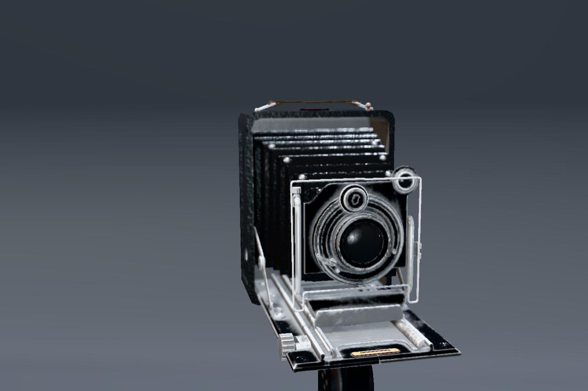

# Blender asset studio

FrostfieldLab renders a Blender-exported antique camera with its textured
metallic-roughness materials. The scene uses a linear HDR light probe, a
contact-hardening key shadow, screen-space ambient occlusion, thin-lens depth
of field, and PBR Neutral tone mapping. The optional light rig comes through
the glTF importer. Drag or pan to orbit. Scroll or pinch to zoom. A still
view submits on demand.



| Runtime | Observed |
| --- | --- |
| M4 Max Mac Studio, macOS 27.2 | [Full scene](scene/pbr-studio-hero-macos.jpg), [detail with HDR lighting](scene/pbr-studio-detail-macos.jpg), [matching detail with fallback ambient](scene/pbr-studio-no-ibl-macos.jpg), and [visible environment](scene/pbr-studio-sky-macos.jpg) captured at 1440 × 960 with Metal API Validation. The two detail captures use the same framing and imported spot and point lights. |
| iPhone 18 Pro Simulator, iOS 27.2 | [Portrait detail](scene/pbr-studio-iphone-simulator.jpg) rendered with the imported lights and Metal API Validation. A preceding build redrew after a pan and held pixel-identical while idle. |
| iPad Pro 13-inch (M5) Simulator, iPadOS 27.2 | [Portrait studio](scene/pbr-studio-ipad-simulator.jpg) rendered with the imported lights and Metal API Validation. |
| Apple Vision Pro Simulator, visionOS 27.2 | [Windowed detail](scene/pbr-studio-vision-simulator.jpg) rendered with the imported lights and Metal API Validation. |

Xcode 27.2 (27B52). Release builds passed for macOS, iOS Simulator,
visionOS Simulator, and unsigned iOS and visionOS device SDKs. The final batch
passed 149 tests in 43 suites with Metal API Validation on Mac. GPU readback
covered HDR lighting, depth of field, shadow penumbra, contact occlusion,
orthographic reflections, clearcoat, and rough refraction with absorption.
The Mac also recaptured Cyber Ocean. The first transmission graph test
expected constant red from a face-shaded material. A pure red emissive
fixture passed the same pixel and mip expectations. The Xcode bridge's
DerivedData path was on a full volume. Builds and tests used `xcodebuild`
with output on the internal drive.

```sh
FrostfieldLab.app/Contents/MacOS/FrostfieldLab --capture-pbr-studio /tmp/studio.png --studio-detail --studio-light-rig
FrostfieldLab.app/Contents/MacOS/FrostfieldLab --capture-pbr-studio /tmp/studio-no-ibl.png --studio-detail --studio-light-rig --studio-direct-only
FrostfieldLab.app/Contents/MacOS/FrostfieldLab --capture-pbr-studio /tmp/vases.png --studio-asset=/path/to/GlassVaseFlowers.glb --studio-no-ao 0
```

The environment probe provides scene-wide diffuse and specular illumination.
The directional key casts a shadow. The additional point and spot lights
contribute direct, unshadowed lighting. Physical mobile and headset validation,
including immersive stereo and sustained performance, remains open.

The Antique Camera by Maximillan Kamps is a CC0 Khronos sample asset. The Lab
keeps its 20,066 triangles, material bindings, and six authored maps. The
bundled textures are resized to 1024 × 1024. The HDR panorama is Greg Zaal's
CC0 Studio Small 03 at its original 1K resolution.
[Camera attribution](../../Examples/FrostfieldLab/FrostfieldLab/StudioCamera-Attribution.txt) · [Environment attribution](../../Examples/FrostfieldLab/FrostfieldLab/StudioLight-Attribution.txt)

## Layered finishes and glass

The same `--studio-asset` path accepts local glTF and GLB files. Two Khronos
assets exercise the extensions under the same studio environment. Both
inputs came from revision `8f492390ddc7a2ae221a1369ef560589cf8c70fb`.

- The [coated wicker](scene/wicker-coated-macos.jpg) shows highlights shaped by
  a separate clearcoat normal map. The [base-only comparison](scene/wicker-base-macos.jpg)
  uses the same asset, with its clearcoat record removed for the comparison.
  Clearcoat Wicker is by Eric Chadwick under CC0. [Asset and license](https://github.com/KhronosGroup/glTF-Sample-Assets/blob/8f492390ddc7a2ae221a1369ef560589cf8c70fb/Models/ClearcoatWicker/README.md)
- The [glass vases on macOS](scene/glass-vase-macos.jpg) compare alpha blending
  on the left with authored transmission and volume on the right. The vase
  shows refracted stems and view-dependent reflections. The same asset ran
  on the [iPhone](scene/glass-iphone-simulator.jpg), [iPad](scene/glass-ipad-simulator.jpg),
  and [Vision Pro](scene/glass-vision-simulator.jpg) simulators with Metal API
  Validation. Contact occlusion was disabled for the glass comparison. Glass
  Vase with Flowers is by Eric Chadwick and Rico Cilliers under CC0.
  [Asset and license](https://github.com/KhronosGroup/glTF-Sample-Assets/blob/8f492390ddc7a2ae221a1369ef560589cf8c70fb/Models/GlassVaseFlowers/README.md)

The transmission pass estimates an exit point from the authored thickness
and samples a mipmapped snapshot of opaque HDR color. It can show rough
glass and colored absorption. Offscreen objects, other transmitting layers,
and caustics require additional techniques. The current directional shadow
map uses opaque and masked geometry.
