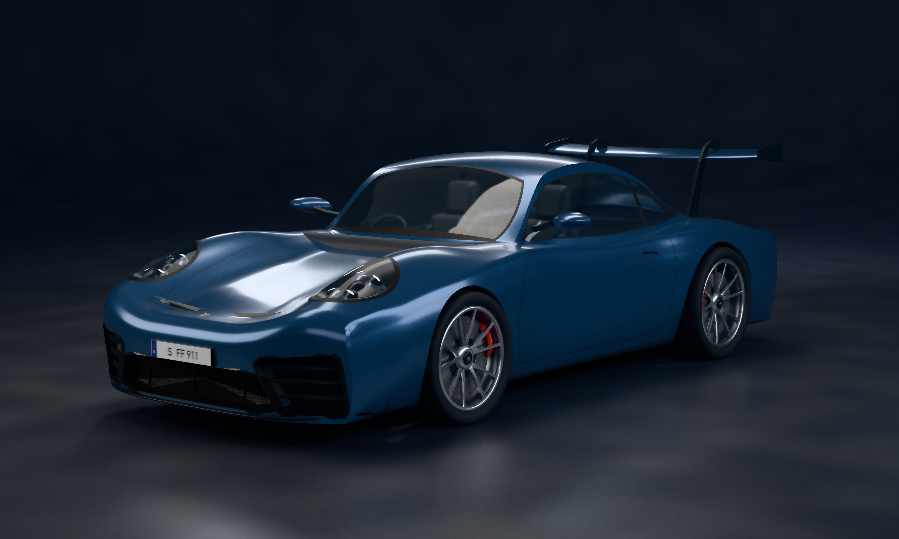

# Procedural Porsche 911 GT3



The Lab generates a 992.2 GT3 in Swift. Spline surfaces shape the body,
including its wheel openings and rolled bumper edges. Separate meshes form
the tinted glazing, cabin, optical headlamps, intake grilles, rear wing,
tires, center-lock wheels, and brakes. The plate lettering, paint variation,
and surface finishes are generated at runtime. Porsche’s photos and chassis
data were used as modeling references.
[Body and aero](https://newsroom.porsche.com/en/press-kits/911-GT3/Aerodynamics-and-design.html) ·
[Reference photography](https://www.porsche.com/stories/design/download-porsche-911-gt3-wallpapers/) ·
[Wheels and brake dimensions](https://newsroom.porsche.com/en/press-kits/911-GT3/Chassis-and-dynamics.html)

Six rectangular area lights illuminate a seamless curved studio. The
metallic-blue finish has a separate dielectric clearcoat, and the windshield
reveals the seats, dashboard, and steering wheel. The model is a
procedural interpretation of the production car.
[Scene and lighting](../../Examples/FrostfieldLab/FrostfieldLab/LabPorscheScene.swift) ·
[Body](../../Examples/FrostfieldLab/FrostfieldLab/LabPorscheBody.swift) ·
[Trim](../../Examples/FrostfieldLab/FrostfieldLab/LabPorscheTrim.swift) ·
[Wheels](../../Examples/FrostfieldLab/FrostfieldLab/LabPorscheWheels.swift)

The Mac Release app built and rendered on an M4 Max with Metal API Validation.
The still uses 512 samples per pixel at 2560 × 1536, up to seven bounces, and
two guided denoising passes. The iceberg and lighting-room capture commands
also completed one-sample checks. The Xcode bridge pointed DerivedData at a full
external volume, so the build used `xcodebuild` with internal DerivedData.

Launch FrostfieldLab with `--porsche` to orbit the car. Capture a still from
the Mac Release app directory with the command below.

```sh
FrostfieldLab.app/Contents/MacOS/FrostfieldLab --capture-porsche /tmp/porsche.png 512
```
