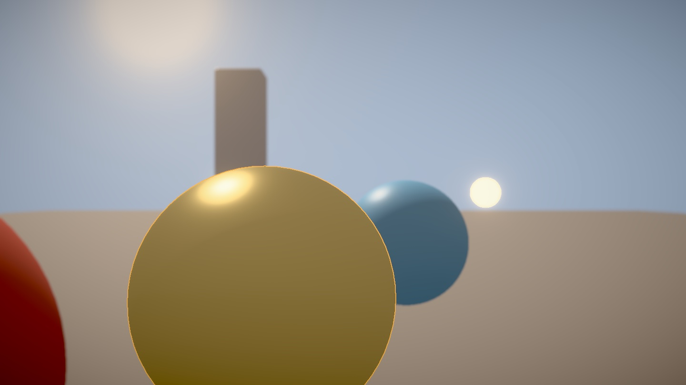

# Post-processing suite



The scene above is rendered by `PostSuiteShowcaseTests` at 1440 × 810 on an M4 Max
Mac. A `PostProcessChain` applies `BokehDepthOfField` (a 32.7 mm lens at f/1.2,
focused on the outlined gold sphere at 2.4 m, six aperture blades), `GodRays`
from a sun disk, a `LensFlare` on the emissive lamp, `MipmapBloom` and a 1.5 px
`SelectionOutline` of the gold sphere. `HDRDisplay` tone maps the result, and a
second chain applies a warm 33³ `ColorLookupPass` and the Three.js vignette.
The [unprocessed frame](scene/postsuite-showcase-plain.jpg) shows the same scene
after tone mapping only. Every effect runs on the raster frame; the path tracer's
output can be fed through the same chain because it is also premultiplied linear
RGBA16Float. `FrostfieldSceneView.postChain(_:)` runs that chain after the raster
scene and before an optional HDR display. The scene target is RGBA16Float. The
chain's destination matches the drawable, or stays RGBA16Float when the display
pass follows. The path-tracing view does not run the chain.

```sh
TEST_RUNNER_FROSTFIELD_POSTSUITE_IMAGES=/tmp/out xcodebuild test -scheme Frostfield-Package \
  -destination 'platform=macOS,arch=arm64' -only-testing:FrostfieldTests/PostSuiteShowcaseTests
```

## Composition

Every new effect conforms to `PostProcessEffect` and runs either on its own or as a
`PostProcessChain` stage through `Effect.pass(_:)`. The chain prepares each effect
for its intermediate and destination formats when the effect is added, so enabling
or bypassing a stage never builds a pipeline. `PostProcessEffectContractTests`
checks this for all eleven effects: after `prepare(pixelFormat:)`, two encodes
build no further render or compute pipeline. Effects keep their settings as
properties; changing them never rebuilds a pipeline either. Depth-reading effects
receive the chain's depth, and a missing depth reports the stage index.

`PostProcessChain.setResolutionScale(_:at:)` runs any stage at 0.125 to 1 of the
output size. The stage reads a reduced copy of its input in which every texel is
the overlap-weighted average of its exact source footprint, so the mean is kept
at any scale, including non-power-of-two ones, and a small highlight is never
skipped. The result is bilinearly upsampled. Stages that read depth must stay at
full size. Bloom, Kawase blur and god rays also have their own internal
resolutions; Kawase reduces its input with the same footprint average.

`PostProcessHistory` gives graphs a previous-frame texture: bind its `texture` to a
graph texture declaration and place the history after the graph in the chain.
`PostProcessGraph.motionTrail` uses it.

## Capabilities

| Capability | Public API | Verified by |
| --- | --- | --- |
| 3D LUT grading, `.cube` and `.3dl` parsing, sizes 2 to 65, trilinear or tetrahedral interpolation, sRGB or linear input, domain mapping, intensity | `ColorLookupTable`, `ColorLookupPass` | `ColorLookupTableParsingTests`, `ColorLookupPassTests`: an identity 33³ table returns the frame within 1.5 × 10⁻³ in all four modes; a nonlinear 5³ table maps lattice inputs to its values within 10⁻³; off-lattice results match the CPU `lookup` within 2 × 10⁻³; `.3dl` lattices of 17 points to 1023, 33 points to 4095 and exact steps parse, and uneven or offset lattices throw `nonuniformLattice` |
| Physically based mip-chain bloom: Jimenez 13-tap downsample, tent upsample, optional Karis firefly suppression, soft-knee threshold or none, energy-conserving or additive | `MipmapBloom` | `MipmapBloomTests`: with energy-conserving blending and no Karis average, total RGB is unchanged within 0.5 % without a threshold (strength 0.5 and 1) and with threshold 1; a uniform frame below the knee is unchanged bit for bit; a dim background below the knee only gains light; additive blending adds exactly `strength` times the input light within 0.5 % |
| Physical lens: focal length, f-number, focus distance, sensor width, field of view, circle of confusion, hyperfocal distance, depth-of-field limits | `CameraLens` | `CameraLensTests` against the closed-form thin-lens formulas |
| Scatter-as-gather bokeh with thin-lens circles of confusion, tile dilation, a foreground layer, polygonal apertures | `BokehDepthOfField` | `BokehDepthOfFieldTests`: the GPU radius equals `CameraLens` at 13 distances from 0.3 m to 90 m, forward and reversed depth, within 10⁻³ relative; a focused plane is unchanged; a step edge at 7.05 px blur stays exact beyond the radius and follows the disk-overlap profile within 0.09; blurred background never reaches a sharp subject; a blurred foreground covers a sharp background and is 57 % opaque 1.5 px inside its own silhouette, as the disk overlap predicts; `encodeCircleOfConfusion` reports unretained or committed command buffers as `.commandBuffer` |
| Selection outline with visible and hidden colors, hidden fill, silhouettes from the selected meshes' own vertex stages | `SelectionOutline` | `SelectionOutlineTests`: with forward and reversed depth (the reversed default view built by the outline itself), the outline appears only around the selected node and in the hidden color where another mesh occludes the edge, and the hidden fill covers the occluded interior; along a straight edge, thickness 0.5, 0.75, 1, 1.5, 2 and 3.25 give per-pixel coverage `saturate(thickness + 1 − d)` within 2 × 10⁻³ and a row total equal to the thickness; the selection mask covers exactly the pixels the color pass draws for blended instanced, blended morphed, skinned morphed, skinned instanced and alpha-masked instanced meshes, and nothing for a mask that cuts every fragment; a morphed transmissive mesh's mask is exactly its projected square |
| Screen-space god rays from a sun disk or the sky | `GodRays` | `GodRaysTests`: a uniform sky adds exactly `intensity · color · mask` for 1, 2 and 3 passes; inside a sun disk's core the result is exactly `intensity · color`, and pixels whose rays never reach the disk are unchanged; occluded pixels whose rays stay behind geometry are unchanged; an occluder casts a darker shaft |
| Lens flare with glare, starburst, a dispersive halo and polygonal ghosts, occluded by depth on the GPU | `LensFlare` | `LensFlareTests`: a ghost lands at the mirrored position with the exact tint; full occlusion leaves the frame unchanged; half occlusion scales it by the exact visible fraction of the test taps; off-frame lights vanish; a projected light beyond the far plane gets no depth (seen only through cleared depth) and one inside the near plane gets the near-plane depth, and both encode |
| Gaussian blur from sigma, integrated kernel | `GaussianBlur`, `GaussianBlur.kernel(sigma:)` | `GaussianKernelTests`: weights sum to 1 within 10⁻⁵ and match the erf mass; `ImageBlurTests`: blurring a delta reproduces the separable kernel at every pixel |
| Kawase blur with preset or custom kernels and a resolution scale | `KawaseBlur` | `ImageBlurTests`: one-iteration CPU reference with edge clamping; energy within 0.3 % at full resolution and at the default half resolution, with a symmetric spread; at scales 0.5, 0.25 and 0.125 a single highlight keeps its energy within 0.5 % at every position inside a grid texel |
| Depth- and color-aware bilateral blur | `BilateralBlur` | `ImageBlurTests`: no color crosses a depth discontinuity that a Gaussian blurs across; with color weighting alone, red and blue halves stay unmixed |
| Afterimage | `Afterimage` (`.maximum(damp:)`, `.blend(persistence:)`) | `PostProcessHistoryTests`: the Three.js formula gives 0.96 and 0.9216 on the next two frames and zeroes components at or below 0.1 |
| Previous-frame textures for graphs | `PostProcessHistory`, `PostProcessGraph.motionTrail` | `PostProcessHistoryTests`: a chain trail halves each frame, including two frames in one command buffer |
| Supersampling by jittered accumulation, summed in single precision | `SupersampleAccumulator` | `SupersampleAccumulatorTests`: each edge pixel equals its exact sample coverage for 4, 16 and 32 samples; for 7, 16, 64, 100 and 256 samples, identical subframes give back the subframe exactly and varying subframes give the half-float mean within one unit in the last place |
| Per-stage resolution scaling | `PostProcessChain.setResolutionScale(_:at:)` | `PostProcessChainEffectTests`: at 1/8, a single highlight keeps its energy within 0.2 of 64 at five positions in its block and stripes average to exactly 0.5; at 0.3, the result matches a CPU footprint average and bilinear upsampling within 8 × 10⁻³ |
| Sepia, hue and saturation, brightness and contrast, color correction, vignette, RGB shift, glitch, halftone, dot screen, pixelate, Sobel, film, luminosity high pass | `PostProcessGraph.sepia`, `.hueSaturation`, `.brightnessContrast`, `.colorCorrection`, `.vignette(offset:darkness:)`, `.rgbShift`, `.glitch` with `GlitchRandomizer`, `.halftone`, `.dotScreen`, `.pixelate`, `.sobel`, `.film`, `.luminosityHighPass` | `PostProcessGraphPresetTests` against CPU implementations of the Three.js formulas on frames with opaque and half-transparent pixels |

The existing `ShaderPass` equivalent is `PostProcessGraph` with `PostProcessPass`,
`OutputPass` is `HDRDisplay`, and `RenderPass` is `SceneGraph.encode`.

Every GPU test was checked to fail when its feature is broken. First round: the
LUT axes swapped, the Gaussian weights flattened, the Kawase offset changed, the
bloom upsample made non-convex, the circle-of-confusion formula inverted, the
outline's visibility reversed, the god-ray normalization dropped, flare occlusion
ignored, the afterimage threshold removed, the history capture skipped, the
jitter sign flipped, each preset's formula altered, chain scaling disabled and
chain depth dropped. After review: half-float SSAA running sums, the old outline
coverage, the forward-only default outline view, no specialized depth pipelines
for blended meshes, the old four-tap chain downsample, Kawase without its
footprint downsample, a broken Kawase final pass, raw projected flare depths, the
old `mix` bloom composite, thresholding after bilinear filtering, premultiplied
dot-screen and halftone inputs, missing compute pipelines in `prepare`, the old
circle-of-confusion error, unchecked `.3dl` lattices, an empty sun mask and
disabled bilateral color weights each turned the matching test red.

## Comparison with Three.js r187

Checked against the r187 sources of the named files.

| Frostfield | Three.js and pmndrs counterpart | Result |
| --- | --- | --- |
| `ColorLookupTable`, `ColorLookupPass` | `LUTPass`, `LUTCubeLoader`, `LUT3dlLoader` | Surpass for 3D tables: tetrahedral interpolation, sRGB or linear input, domain mapping, premultiplied alpha. Partial overall: no 1D tables. |
| `MipmapBloom` | `UnrealBloomPass`, pmndrs `BloomEffect` with `MipmapBlurPass` | Surpass: energy-conserving blending verified with and without a threshold, Karis average, soft knee. |
| `CameraLens`, `BokehDepthOfField` | Core `PerspectiveCamera` (`filmGauge`, `setFocalLength`, `focus`); `BokehPass`; `BokehShader2` (`focalLength`, `fstop`, CoC, pentagon bokeh); TSL `DepthOfFieldNode` (near and far fields); pmndrs `DepthOfFieldEffect` | Match. Thin-lens circles of confusion, polygonal apertures and foreground handling all exist in Three.js; Frostfield's single full-resolution gather is not better than them. |
| `SelectionOutline` | `OutlinePass` (morph targets, skinning, `instanceMatrix`, `pulsePeriod`, `edgeGlow`, pattern texture, downsampling); TSL `OutlineNode` | Partial: visible and hidden colors, hidden fill and deformed silhouettes match; no pulse, glow blur or pattern texture. |
| `GodRays` | r187 example uses three-good-godrays; TSL `GodraysNode` ray-marches the shadow map | Partial: Frostfield's god rays are a screen-space radial blur, not volumetric. |
| `LensFlare` | `Lensflare` addon (GPU occlusion map, fractional visibility) | Match: procedural glare, starburst, halo and ghosts need no textures, but Three.js also measures fractional visibility on the GPU. |
| `GaussianBlur`, `KawaseBlur` | `GaussianBlurShader`, `HorizontalBlurShader`/`VerticalBlurShader`, pmndrs `KawaseBlurPass` | Match. |
| `BilateralBlur` | TSL `BilateralBlurNode`, `depthAwareBlur`, `DepthLimitedBlurShader` | Match. |
| `Afterimage` | `AfterimagePass` | Match: same formula, plus a linear blend mode. |
| `SupersampleAccumulator` | `SSAARenderPass` | Match: the 1, 2, 4, 8 and 16 sample tables equal r187's `_JitterVectors`; other counts up to 256 use Halton points. The mean is accumulated in single precision. |
| `PostProcessHistory` | none | Surpass: previous-frame textures for any graph. |
| `setResolutionScale(_:at:)` | pmndrs `resolutionScale` | Partial: generic footprint downsampling and bilinear upsampling around a stage. |
| Sepia, hue/saturation, brightness/contrast, color correction, vignette, RGB shift, dot screen, film, luminosity high pass presets | The Three.js shaders of the same names | Match: same formulas on straight color, premultiplied once. |
| `.sobel` | `SobelOperatorShader` | Match, on Rec. 709 luminance where Three.js reads a prior luminance pass's red channel. |
| `.pixelate` | `RenderPixelatedPass` (low-resolution render plus `normalEdgeStrength` and `depthEdgeStrength` highlights) | Partial: block sampling only. |
| `.glitch`, `.halftone` | `GlitchPass`, `HalftonePass` | Partial: the glitch uses a hash instead of the random texture; halftone has round dots only. |
| none | pmndrs `EffectPass` (merged effects) | Not implemented. |

## Measured cost

GPU time from command-buffer timestamps on an Apple M4 Max (32-core GPU), macOS
27.2, at 1920 × 1080 with the showcase scene's color and depth, Metal API
Validation off, median of seven runs after two warm-ups. Each figure is one effect
alone in its own command buffer.

Three timing runs were made; each figure is the median of the three run medians,
with the range of run medians where it moved by more than 10 %. The first effect
measured varies most between runs.

| Effect and settings | GPU median |
| --- | ---: |
| `GaussianBlur`, sigma 4 (25 taps per axis) | 0.69 ms (0.61 to 1.16) |
| `KawaseBlur`, medium kernel, half resolution (with its footprint downsample) | 0.15 ms |
| `KawaseBlur`, medium kernel, quarter resolution | 0.12 ms |
| `BilateralBlur`, sigma 3, depth weighting | 0.59 ms (0.58 to 0.73) |
| `MipmapBloom`, 6 levels, no threshold | 0.23 ms |
| `MipmapBloom`, 6 levels, threshold 1 (per-texel thresholding) | 0.27 ms (0.27 to 0.35) |
| `BokehDepthOfField`, 96 taps, 16 px maximum radius | 3.39 ms (3.17 to 4.17) |
| `GodRays`, 2 passes × 32 taps, half resolution | 0.17 ms |
| `LensFlare`, one light, six ghosts | 0.21 ms |
| `SelectionOutline`, 2 px, including the selection depth pass | 0.14 ms |
| `ColorLookupPass`, 33³, tetrahedral | 0.06 ms |
| `Afterimage` | 0.03 ms |

```sh
TEST_RUNNER_FROSTFIELD_POSTSUITE_TIMING=1 xcodebuild test -scheme Frostfield-Package \
  -destination 'platform=macOS,arch=arm64' -only-testing:FrostfieldTests/PostSuiteShowcaseTests
```

These are single runs on one Mac. They are not iPhone, iPad or Vision Pro numbers
and no comparison with Three.js on the same hardware was made.

## Limits

- The bokeh gathers at full resolution with a fixed tap count spread over each
  tile's largest radius, so very large radii leave visible sampling noise; there is
  no half-resolution path or post-filter yet. Its blur scale assumes the image spans
  the sensor width; give the renderer's camera the lens's field of view
  (`CameraLens.perspectiveCamera`) for a consistent result. Foreground coverage is
  estimated from samples, so a defocused foreground's edge varies by about 0.1.
- The outline is drawn outside the silhouette only. Three.js's pulse, glow blur
  and pattern texture are not reproduced; animate the colors to pulse. Blended and
  transmissive meshes outline their full geometry, whatever their opacity.
- God rays and the flare are screen-space: geometry outside the frame cannot cast
  shafts, and the flare's occlusion test uses only depth near the light.
- `ColorLookupTable` rejects 1D tables, lattices above 65 points and `.3dl`
  lattices that are not evenly spaced from 0, and HDR input is clamped to the
  table domain, so grade after tone mapping.
- Energy conservation of bloom holds away from the frame edges, where clamp-to-edge
  sampling changes the total, and only without the Karis average.
- Resolution scaling is generic down- and upsampling around a stage; it does not
  keep full-resolution detail for additive effects. Stages that read depth cannot
  be scaled.
- `SupersampleAccumulator` keeps two RGBA32Float running sums besides its
  subframe target: 48 bytes per pixel, about 100 MB at 1920 × 1080.
- `PostProcessHistory` has a fixed size; recreate it and the graph stage on resize.
- Merging several graph effects into one pass (pmndrs `EffectPass`) is not
  implemented; each graph stage is its own full-screen pass.
- Tone mapping operators, FXAA, SMAA, TAA, SSR, GTAO and cascaded shadows belong to
  other work and are not part of this suite.
- Only the macOS GPU was used. The compute passes use whole threadgroups and no
  sRGB compute writes, as the iOS Simulator requires, but no Simulator or device run
  was made for this suite.
