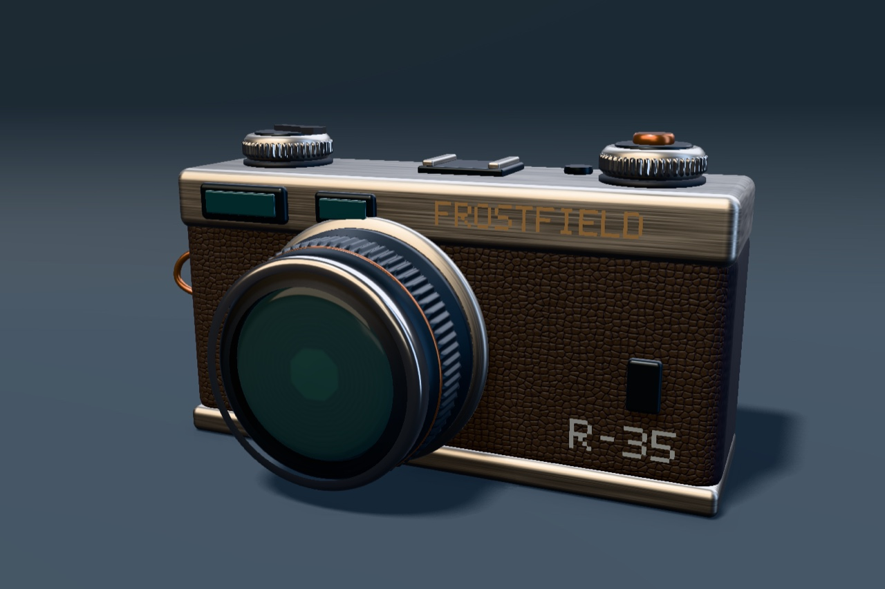

# Procedural rangefinder

FrostfieldLab builds the R-35 rangefinder in Swift when the scene opens.
Rounded solids form the body. Revolved profiles form the lens and controls.
A parametric radial profile adds knurling. A concave outline extrudes into
the winding lever, and a Bézier sweep forms the cord loop. The face lettering
is made from quads. Seeded leather and brushed-metal maps supply fine detail,
and a custom UV function draws the iris behind the curved transmitting glass.
An HDR panorama generated from analytic softboxes lights the whole scene.
[Model source](../../Examples/FrostfieldLab/FrostfieldLab/LabProceduralCamera.swift) · [Lighting source](../../Examples/FrostfieldLab/FrostfieldLab/LabProceduralLighting.swift)



| Runtime | Render |
| --- | --- |
| M4 Max Mac Studio, macOS 27.2 | [Front](scene/procedural-camera-hero.jpg), [lens detail](scene/procedural-camera-detail.jpg), [rear](scene/procedural-camera-rear.jpg) |
| iPhone 18 Pro Simulator, iOS 27.2 | [Portrait](scene/procedural-camera-iphone-simulator.jpg) |
| iPad Pro 13-inch (M5) Simulator, iPadOS 27.2 | [Portrait](scene/procedural-camera-ipad-simulator.jpg) |
| Apple Vision Pro Simulator, visionOS 27.2 | [Windowed](scene/procedural-camera-vision-simulator.jpg) |

All captures ran with Metal API Validation. The Mac generated identical PNG
bytes with a normal app build and a temporary app copy with the bundled
sample models, HDR panorama, and light rig removed. The compiled Metal
library stayed in place. Release builds passed for native macOS, iOS and
visionOS simulators, and unsigned iOS and visionOS device SDKs. The
package passed 168 tests in 48 suites on Mac, including mesh winding,
cap and seam coverage, and generated texture channels and mip levels.
Xcode 27.2 (27B52). The Xcode bridge could not write DerivedData on the full
external volume, so the builds and tests used `xcodebuild` with internal
output paths. Physical mobile and headset performance remains open.

Launch FrostfieldLab with `--procedural-camera`. Drag or pan to rotate.
Scroll or pinch to zoom. For repeatable 1440 × 960 Mac captures, use the
built application executable.

```sh
FrostfieldLab.app/Contents/MacOS/FrostfieldLab --capture-procedural-camera /tmp/rangefinder.png
FrostfieldLab.app/Contents/MacOS/FrostfieldLab --capture-procedural-camera /tmp/rangefinder-detail.png --studio-detail
FrostfieldLab.app/Contents/MacOS/FrostfieldLab --capture-procedural-camera /tmp/rangefinder-rear.png 2.71
```

The geometry and materials use the same interfaces as other Frostfield
scenes. For example, a profile and a seed are enough to build a new part.

```swift
let barrel = try MeshGeometry.lathe(profile: [
    .init(radius: 0.54, y: 0),
    .init(radius: 0.60, y: 0.04),
    .init(radius: 0.60, y: 0.34),
    .init(radius: 0.56, y: 0.40),
])
let finish = try ProceduralSurface(device: device, style: .brushedMetal, seed: 35)
let mesh = try MeshRenderer(
    device: device, colorPixelFormat: .rgba16Float, geometry: barrel,
    material: .physicallyBased(try finish.material())
)
let node = SceneNode(mesh: mesh)
```
