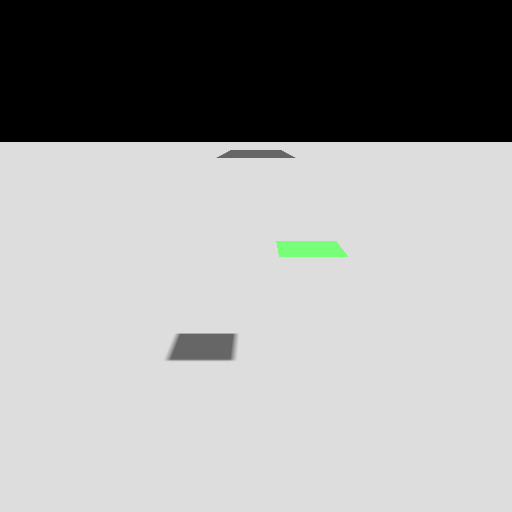
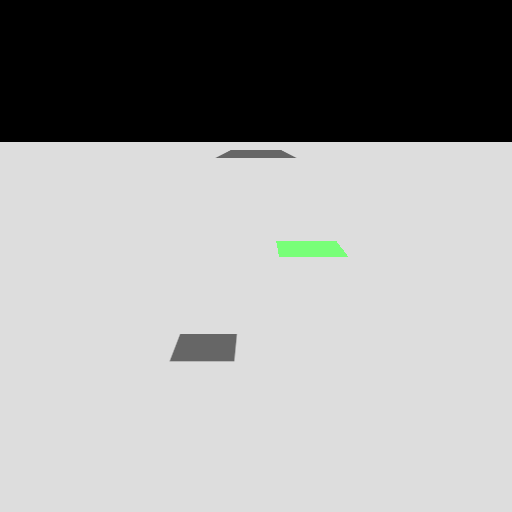
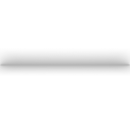
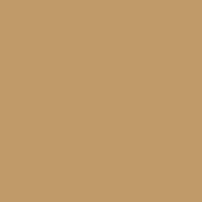
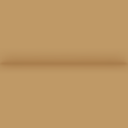
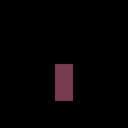
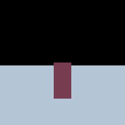

# Raster lighting: cascaded shadows, GTAO and screen-space reflections

This page records the raster lighting added for photoreal previews: cascaded
directional shadow maps, ground-truth ambient occlusion (GTAO) with bent normals
that feed PBR shading, and screen-space reflections (SSR). The path tracer
computes visibility and reflections by tracing rays.

| Capability | Public API | Renderer | Verified by |
| --- | --- | --- | --- |
| Cascaded directional shadows | `DirectionalShadowMap(queue:resolution:directionToLight:cascades:...)`, `DirectionalShadowMap.Cascades`, `fitCascades(camera:cameraTransform:aspectRatio:)` and its custom split overload, `fitCascades(view:splitFractions:)`, `update(directionToLight:intensity:bias:lightAngularRadius:)`, `cascadeSplits`, `texelSizes`, `practicalSplits(near:far:count:lambda:)` (throws `Failure.invalidSplits`); `FrostfieldSceneView` refits a cascaded map every frame | Raster | `CascadedShadowSplitTests`, `CascadedShadowMapTests` |
| Surface attribute prepass | `SceneGraph.encodeSurfaceAttributes(pass:commandBuffer:)` and its explicit-view overload, `SceneGraph.surfaceAttributesPixelFormat`, `MeshRenderer.prepareSurfaceAttributes()` | Raster | `GroundTruthOcclusionTests` (attribute contents), the GTAO and SSR suites |
| GTAO with bent normals | `AmbientOcclusion.encodeVisibility(depth:surfaceAttributes:destination:camera:cameraTransform:...)` and `encodeVisibility(depth:surfaceAttributes:destination:clipFromView:worldFromView:...)`; `AmbientOcclusion.encode(source:...)` uses the same estimator; `Settings.sliceCount`, `stepCount`, `falloff`, `maximumScreenRadius`, `denoise`, `poisson` | Raster | `GroundTruthOcclusionTests`, `AmbientOcclusionTests` |
| Indirect-only occlusion in PBR | `SceneGraph.encode(..., screenSpaceOcclusion:)` on both overloads | Raster | `GroundTruthOcclusionTests` |
| Screen-space reflections | `ScreenSpaceReflections`, `Settings`, `encode(source:depth:surfaceAttributes:destination:camera:cameraTransform:...)` and `encode(...clipFromView:worldFromView:...)` | Raster | `ScreenSpaceReflectionTests` |

Readbacks below come from the M4 Max Mac Studio package tests on macOS 27.2
with Xcode 27.2 and Metal API Validation enabled.

## Cascaded shadow maps

`SunLight` owns an ordinary `DirectionalShadowMap` that fits the active
scene camera before a color encode. Defaults are two 1024² practical
cascades, split lambda 0.5, a 500-unit distance cap, and 10% blend bands.
Aim the sun directly or use a `SolarPosition`. Pass its map through the
existing shadow receiver path. Explicit projections supply the matching
`ShaderGraphCamera`. Manual shadow maps retain their separate fit
workflow. The receiver path uses scalar directional illuminance.

All 27 focused tests passed on Mac and iPhone 18 Pro Simulator with Metal
API Validation. Tests compare a non-square fitted view to a manual
reference and verify shadow pixels after camera translation and re-aiming,
on-demand reuse, and a shifted reversed orthographic view.

Directional maps expose `normalBias` in world units and a separate
`shadowStrength` in the range 0–1. Bias offsets the receiver along its
geometric normal at lookup. Strength blends the sampled visibility with
full visibility while preserving the light's intensity. The focused Mac
and iPhone 18 Pro Simulator runs each passed 40 tests with Metal API
Validation, including raster receiver readbacks and rejected invalid
controls.

Point, spot and rectangle-proxy lights expose their own `shadowStrength`.
The receiver blends the sampled visibility toward full visibility while
leaving light intensity and the stored shadow depth intact. Native archive
v26 preserves nondefault strength. The 52 focused tests passed on Mac and
iPhone 18 Pro Simulator with Metal API Validation.

 

A cascaded map splits the view range with the practical scheme
`λ·n·(f/n)^(i/N) + (1−λ)·(n + (f−n)·i/N)`. It fits each cascade to the bounding
sphere of its frustum slice and snaps the sphere's light-space center to whole
texels, in depth as well. The sphere's radius depends only on the camera's
intrinsics and splits, so camera motion never rescales the grid. Each slice
extends back over the previous cascade's blend band, so both cascades cover
that band. The depth range reaches `casterMargin` toward the light. One
Depth32Float array texture holds the maps, one slice per cascade. The scene
graph renders one caster pass per cascade and culls casters by that cascade's
light frustum.

Shading picks the cascade by view distance along the camera axis. The last
`blendFraction` of each cascade's range cross-fades into the next, and the last
cascade fades to unshadowed and ends at `maximumDistance`. The first cascade's
range starts at the fitted camera's near plane, matching the sphere fit. A
cascaded map with `count: 1` takes the same path; only a map made with
`init(…center:halfExtent:…)` is the single map. The shadow record is rebuilt
when the map is created, re-aimed or refitted, not for every draw.

The contact-hardening filter measures blocker distance and penumbra in world
units through each map's depth-per-UV scale. Its penumbra therefore has the same
world width in every cascade, capped at 16 texels of that cascade.

| Check (512² view, 60° field of view, light at 45°) | Single 2048² map over a 100 m cube | Four 1024² cascades, λ = 0.75, 100 m range |
| --- | --- | --- |
| Texel size (m) | 0.0488 | 0.0109, 0.0237, 0.0512, 0.159 |
| Split distances (m) | — | 6.69, 14.88, 32.09, 100 |
| Near shadow edge, 4.4 m away: pixels between 10% and 90% | 6 and 6 | 1 and 1 |
| Far shadow edge, 58 m away: pixels between 10% and 90% | 1 and 1 | 2 and 2 |

The test asserts at least 3 transition pixels on each near edge with the single
map. With cascades it allows at most 2, and at most half the single map's width.
A cascade texel's 0.8-texel comparison ramp spans about one pixel there, so it
covers one or two pixels depending on where the edge falls in the texel grid. The
far edge may use at most 2 pixels with either map. The test passes for
`shadowedLambert`, PBR and classic Lambert receivers.

| Rendered check, light straight overhead, shadowed Lambert ground (0.16 + 0.84 · visibility) | Measured |
| --- | --- |
| Last-cascade fade: a plate shades the ground well past `maximumDistance` = 10 m, blend 0.2; visibility per row against `saturate((d − (10 − band)) / band)`, then 1 beyond 10 m | 1 cascade: 20 rows in the band, 26 beyond, largest error 0.00051. 2 cascades: 15 and 26 rows, 0.00053 |
| Blend band: a plate 6 m up lies outside the first cascade's depth range (caster margin 0) and inside the second's, so the first cascade reads lit and the second shadowed. Near plane 1 m, split 4.98 m, blend 0.5; visibility against `1 − (d − 2.99)/(4.98 − 2.99)` | 109 rows in the band, largest error 0.00058 |
| Contact hardening in two cascades, light angular radius 0.15 rad, plates 1 m above the ground at 3.5 m and 12 m: mean 10%–90% penumbra width along X | near 0.204 m over 72 edges (texel 0.0108 m), far 0.198 m over 32 edges (texel 0.0319 m); a disk filter of radius `h·tan θ` predicts 0.208 m |

The contact-hardening test requires the two widths to agree within 15% of the
prediction and each to lie within 25% of it. Stability: a top-down camera 8 m
above the ground moves by one pixel (0.036 m, 0.566 of the cascade texel). After
the cascades are refitted, every ground pixel equals its neighbor in the previous
frame exactly: the largest difference is 0.0 across 340 partly shadowed pixels.
With the snapping removed the same move changes edge pixels by up to 0.54 and the
test fails, while the sharpness test still passes.

The practical split helper requires finite distances with `0 < near < far`,
one to four cascades and λ between zero and one.

Pass `splitFractions` to position the interior boundaries within the range
from the camera near plane to the capped far distance. A two-cascade map
with a near plane of zero, a maximum distance of 7 and `[0.25]` splits at
1.75 and 7. Invalid fractions leave the existing fit intact. Re-aiming the
light keeps those splits.

The explicit-view overload accepts the projection and rigid pose already
carried by `GLTFScene.Camera.View.graphCamera`. It uses the actual slice
extents for shifted perspective and orthographic projections. A zero
orthographic near plane defaults to uniform splits. The shifted
orthographic GPU fixture checks lit, shadowed and fade-band rows at three
horizontal positions with forward and reversed depth.

## Surface attribute prepass

`SceneGraph.encodeSurfaceAttributes` draws every opaque and masked mesh once more,
into an RG32Uint target with its own depth. The first word holds the world-space
shading normal as snorm16 octahedral coordinates. The second holds √ of the RGB
split-sum specular reflectance `(F0·A + F90·B)·occlusion` at the view angle, and
the perceptual roughness, as unorm8 values. `occlusion` is the material's
occlusion map, which shading also applies to its image-based reflection, so
reflections replace exactly what shading added. The prepass uses the material's
lookup table when it has an environment and Karis's analytic fit otherwise. PBR
meshes write normal-mapped or graph-authored normals and honor the KHR specular
layer. Non-PBR and unlit meshes write their normal with zero reflectance. The
prepass preserves PBR and classic alpha cutouts and skips blended meshes and
point, line, and sprite primitives. The test decodes the target on the CPU: normals match within 1e-3,
roughness within half a unorm8 step, and reflectance matches Karis's fit at
each pixel's view angle within the square-root unorm8 resolution.

Each mesh compiles its attribute pipeline on first use;
`MeshRenderer.prepareSurfaceAttributes()` compiles it ahead of a frame.

## Ground-truth ambient occlusion



GTAO follows Jimenez et al. 2016 and the structure of Intel's implementation.
[XeGTAO](https://github.com/GameTechDev/XeGTAO) Each pixel
finds horizons on both sides of `sliceCount` screen-space slices, integrates the
cosine-weighted visible arc in closed form, and integrates the bent normal with
the paper's formulas. These choices make open surfaces exact:

- Samples lie on the exact slice line, and depth is blended bilinearly from a
  gathered 2×2 block. Metal depth is affine in screen space across a plane, so
  coplanar samples never raise a horizon. Across a depth jump the covering
  texel's depth is used. Samples past the outermost texel centers are skipped,
  because their 2×2 block would leave the texture and clamp.
- The visible integrals of all slices, each weighted by the length of the
  projected normal, are divided once by the same weighted sum of the slices'
  unoccluded integrals, `cos n + n·sin n`. The bent normal is corrected the same
  way with the unoccluded mean direction. Horizon raises below 1e-5 in cosine are
  treated as rounding, and raises that integrate to no occlusion bend nothing.
- The intermediate stores occlusion and the bend, not visibility and the bent
  normal. Apple GPUs truncate when storing half floats, which would turn
  0.9999999 into 0.99951.

Without surface attributes, normals come from depth differences, one-sided at the
screen border. A 4×4 rotation pattern spreads slices and step offsets over
neighbors. A 4×4 filter averages them, weighted by distance from the center's
tangent plane (within two pixel footprints) and by `(n·n')⁸`.

`encodeVisibility` writes the world-space bend, `strength · (bent normal − measured
normal)`, and visibility `1 − strength · occlusion`. Shading adds the bend to each
fragment's own shading normal, so normal maps survive, open surfaces (zero bend)
are untouched, and `strength: 0` is exactly neutral.

For standard depth, GTAO and SSR invert a general perspective projection:
`NDC = (sx·x/d − kx, sy·y/d − ky)` with `1/d` affine in stored depth, read from the
matrix. Off-center frustums, such as a headset eye's, and unequal horizontal and
vertical focal lengths are supported. Slices step through the screen so that
their back-projection runs along the slice's view-space direction.

GTAO also accepts an axis-aligned orthographic projection through its explicit
color and visibility routes. Orthographic view distance is linear in stored
depth, XY is independent of distance, and all pixels use the same view
direction. The passes reject shear, a depth mapping that contradicts
`depthMode`, and non-rigid view transforms.

GTAO also reads native logarithmic perspective depth from a matching
`PerspectiveCamera` or `ShaderGraphCamera`. The latter carries the authored
clip planes alongside a forward clip matrix for off-center and jittered
views, even when that Float matrix loses the finite far plane. The pass
decodes the same logarithmic mapping as the mesh rasterizer and interpolates
reciprocal view depth inside continuous planar neighborhoods. The mesh
renderer keeps linear orthographic depth in logarithmic mode, and GTAO uses
that same mapping. [Three.js r187 ViewportDepthNode](https://github.com/mrdoob/three.js/blob/r187/src/nodes/display/ViewportDepthNode.js)

Set `Settings.thickness` to cap each horizon sample's view-axis separation
in world units. `normalBias` excludes samples close to the receiver's tangent
plane, and `visibilityExponent` shapes the integrated visibility before
spatial filtering and strength. The regular settings retain the analytic
horizon estimator. [Three.js r187 GTAONode](https://github.com/mrdoob/three.js/blob/r187/examples/jsm/tsl/display/GTAONode.js)

`Settings.resolutionScale` renders the horizon gather into a smaller Metal
attachment. Each reduced texel uses the closest visible full-size depth
around its mapped center. The full-size resolve rejects incompatible normals
and off-plane samples, and preserves cleared depth. It uses geometry-guided
bilinear taps or a wider neighborhood when denoising is enabled. Temporal
history and PBR input stay at full size. `Settings.screenSpaceRadius` sets a
fixed projected search radius in full-size pixels, bounded by
`maximumScreenRadius` even for unequal horizontal and vertical focal lengths.
The world-radius projection and full-size gather remain the defaults.
[Three.js r187 GTAOPass](https://github.com/mrdoob/three.js/blob/r187/examples/jsm/postprocessing/GTAOPass.js)

Set `Settings.poisson` and leave denoising enabled to select the legacy
GTAO spiral filter for visibility and world-space bends. It exposes sample
count, rings, full-size pixel radius, radius exponent, visibility tolerance,
world-space receiver-plane tolerance, normal similarity exponent, and a
deterministic rotation index. Defaults match the legacy pass's settings.
The Metal filter uses nearest in-bounds taps and rotates the kernel with
Frostfield's Bayer pattern. At reduced resolution each tap uses the trace
texel's closest-depth guide and a tighter receiver-plane tolerance.
A nil `poisson` retains the standard spatial filter. Setting `denoise` to
false bypasses the Poisson filter. The color route preserves source alpha.
[Three.js r187 PoissonDenoiseShader](https://github.com/mrdoob/three.js/blob/r187/examples/jsm/shaders/PoissonDenoiseShader.js)

`Settings.sceneClipBox` limits the receiver region. Visibility and bent
normals retain full strength inside the box and fade over one search radius
outside it, using Euclidean distance to the box. A fixed pixel radius uses
the vertical focal scale at the receiver depth. With a view pose the box is
in world space. Color encodes that take only a projection interpret it in
view space. The mask is applied during the full-size resolve so reduced
traces and denoising keep receivers outside the fade exactly neutral.
`sampleDistanceExponent` controls tap spacing. Its default of two keeps the
existing quadratic spacing, and one spaces the taps linearly.
[Three.js r187 GTAO shader](https://github.com/mrdoob/three.js/blob/r187/examples/jsm/shaders/GTAOShader.js)

For temporal visibility, supply `AmbientOcclusion.TemporalFrame` to
`encodeVisibility`. Advance its index to rotate slices and vary the step
phase. Retain the previous output, depth, camera and optional packed normals
as `TemporalFrame.Previous`, and use a separate current destination. The
pass reprojects the current surface through the supplied prior
view, checks each bilinear tap against prior depth and normal, and blends
the world-space bend and visibility. This follows camera motion through
world-stationary geometry. To follow independently moving receivers, supply the
current view's full-size `RasterMotionVectors` texture as
`TemporalFrame.motionTexture`. It must describe the same prior view as
`TemporalFrame.Previous`. RG already includes projection jitter, B holds
the previous raw depth in half precision, and A marks a usable vector.
Each tap checks prior depth in its stored encoding and checks world-space normal
agreement. Invalid vectors leave current visibility and bends intact. Rotations
that significantly change the receiver's normal reject history. Omit the
previous frame after a camera cut or a change to the occlusion settings.
Camera-only history can mix logarithmic perspective, standard perspective,
and orthographic depth. `RasterMotionVectors` rejects logarithmic recording,
so omit its motion texture whenever either frame uses logarithmic mode.
Supply the prior encode's settings with bounded history. Changing the box
discards that history. When the box stays fixed, each accepted tap is
weighted by its prior coverage and uses the current receiver's fade.

The bounds tests compare independently reconstructed floor points inside,
alongside and beyond the fade. They exercise full-size and reduced
Poisson resolves, preserved HDR alpha, changed sample spacing, and history
discard when the box changes. All 48 focused tests passed on Mac and
iPad Pro Simulator with Metal API Validation. An unbounded Metal A/B
comparison covered 681,984 half-float channels with zero differences.

Reference: a floor point at distance `d` from an infinitely tall wall, counting
occluders within `R`, has cosine-weighted visibility
`V(d) = 1 − (atan(ρ/d) − ρ·d/R²)/π` with `ρ = √(R² − d²)`. That is ½ at the
crease and 1 for `d ≥ R`. The bent normal's tilt away from the wall comes from
quadrature over the hemisphere.

| Corner check (256², R = 0.5, hard radius) | Result |
| --- | --- |
| 8 slices × 32 steps, unfiltered: largest error over 108 floor pixels from 3 px to 0.75 m | 0.0138 |
| Same, pixel nearest the crease, against `0.5 + (2/π)·d/R` | within 0.01 |
| Bent normal tilt at d = 0.111 m | 23.84°, quadrature 23.95° |
| Off-center projection (principal point shifted by (−0.35, 0.25) in NDC, horizontal focal length × 1.3), yawed camera, forward and reversed depth | Largest error 0.0138 over 563 fully visible samples. 121 samples with potentially clipped occluders have excess occlusion below 0.0072. All 1,568 open floor samples read exactly one with zero bend. Tilt 24.65° against 24.89° |
| Defaults (3 slices × 8 steps, filtered): mean / largest error | 0.018 / 0.044 |
| Open floor beyond R, filtered and unfiltered, with and without stored normals | visibility exactly 1, bend exactly 0 |
| Depth-only normals vs stored normals near the crease, including both border columns | within 0.03 |

With 3 steps per side the defaults' error grows to 0.031 mean and 0.079 largest:
sparse samples underestimate the horizon. The defaults therefore stay at 8 steps.
The existing step-edge test in `AmbientOcclusionTests` passes unchanged with GTAO.
It checks forward and reversed depth, exact pass-through on open surfaces and the
sky, zero strength, and sub-pixel radii.

The control fixture checks the view-axis thickness cutoff, normal bias,
visibility exponent and bent-normal preservation. The temporal fixture
reprojects a moved, jittered camera across both depth conventions, compares
stored and reconstructed prior normals, and checks exact history rejection
for a changed normal or receiver depth. Both the full-size and 128×128
gathers resolve temporal visibility at 256×256. The odd-size depth-step
fixture gathers at 21×13 for a 41×25 output and keeps sky pixels, the
foreground side of the edge and source alpha exact. The fixed-radius
fixture verifies that an oversized requested radius with a smaller cap
matches the smaller authored radius. Shifted orthographic fixtures verify a
stable world footprint under camera dolly, exact sky, color composition,
and full and reduced tracing. Mixed-projection history rejects stale depth
and normals in both depth conventions. A Mac GPU comparison preserved all
387,072 tested half channels of perspective horizons, visibility and beauty
at both resolutions with both normal sources. The Poisson fixture independently
evaluates the spiral and weights against raw GPU visibility and bend samples.
It checks the disabled filter's exact output and a changed rotation index.
The odd-size edge fixture checks Poisson color composition and alpha at both
trace scales. Mixed-projection history also passes with Poisson in both depth
conventions. An independently moving floor supplies real raster vectors with
camera motion and jitter. It carries visibility and the bend to the matching
receiver and rejects a parallel prior blocker, invalid vectors, and vectors
that point outside the previous view. The Mac GPU comparison found zero
differences in 681,984 half channels of spatial and camera-only history outputs
against the preceding Poisson implementation with motion omitted.

The logarithmic fixture renders a distant corner with a near-to-far ratio of
one trillion. It checks raw depth against the authored formula, visibility
against the corner reference, and visibility and bends against reversed
depth. The scene-camera path traces at full size and the jittered explicit
view traces at half size with Poisson filtering. Both keep HDR source alpha
and cleared pixels exact. Temporal tests mix logarithmic perspective with
reversed and linear orthographic inputs and reject invalid history. A second
Mac GPU comparison found zero differences across 681,984 half channels with
logarithmic decoding disabled. All 57 focused tests passed on macOS and
iPhone 18 Pro Simulator with Metal validation. The Xcode bridge timed out
resolving the package destination, so the checks used `xcodebuild`.

### PBR integration

 

With `screenSpaceOcclusion`, opaque and masked PBR surfaces look up diffuse
irradiance around their shading normal plus the bend. The material's occlusion
map darkens indirect light exactly as without screen occlusion. Screen visibility
below it darkens further: with `v = min(1, V / material occlusion)`, diffuse
image-based and ambient light take Jimenez's multiple-bounce fit of `v` with the
diffuse albedo, capped at one. Specular image-based light takes the same fit,
with F0, of the specular occlusion: the solid-angle overlap of the reflection
lobe's cone with the visibility cone (`cos² = 1 − v`), divided by the lobe's
overlap with the open hemisphere around the surface normal. The lobe cone holds
three quarters of the equivalent Phong lobe's energy. Dividing by the open
overlap, instead of the whole lobe, keeps the result continuous as `v` reaches 1:
the split-sum terms already account for the horizon. Clearcoat reflections use
the coat's normal and roughness. Direct light, punctual lights, emission and
transmission are not occluded, and blended draws ignore the texture.

| PBR check (256² corner unless noted) | Result |
| --- | --- |
| Uniform environment, zero specular: occluded color against unoccluded × `multipleBounce(V, albedo)` over more than 1,000 sampled pixels | within 0.2% per channel |
| Gradient environment, diffuse only: occluded color at 0.05, 0.1 and 0.2 m from the crease against a plane facing the measured bent normal × `multipleBounce(V, albedo)` | relative error at most 0.00039; the bent normal's light differs from the floor normal's by 8.8% to 16.3% |
| Metal, roughness 0.5, uniform environment: occluded / open reflection at 23 distances from 0.02 to 0.46 m against the cone formula above | 9 partial values from 0.043 to 0.992 agree within 0.0003; nearer the wall the reflection is wholly hidden, farther out not at all |
| `strength: 0`, gradient environment, material occlusion map 0.5, with and without stored normals | occlusion texture is exactly (0, 0, 0, 1); shading is bit-identical to no occlusion input |
| Open, normal-mapped floor (normal map changes the center's light by 11%), depth-only normals, filtered and unfiltered | bend at most 1.9e-7; visibility at least 0.99951 (one half-float step); largest relative change 0.52% unfiltered, 0.40% filtered; 97.0% and 99.7% of pixels bit-identical |
| Directional light only | bit-identical with and without the occlusion input |
| Metallic corner, roughness 0.3: crease and open floor | crease loses at least 10% of its reflection; open floor bit-identical; no pixel brightens |

The residual change on the open normal-mapped floor comes from depth-only normals
at grazing distances: Depth32Float rounding tilts them by about 1e-3 radians, which
leaves a half-float step of occlusion. With stored normals the open floor is exact.

## Screen-space reflections

 

The pass reflects the view ray about the stored normal and marches it in screen
space with perspective-correct depth, at most one step per pixel. It then bisects
the first crossing. A crossing hits when the ray is behind stored depth by less than
`thickness` and reaches the front of the hit surface. The hit color is weighted by
the stored reflectance and by a confidence that fades between half and all of
`maximumRoughness`, within `edgeFade` of the screen edge, and over the last 20% of
`maximumDistance` measured along the reflected ray in world units. The march
parameter runs along the screen, so the pass converts it to the ray's view-space
fraction `t·(1/z₁) / mix(1/z₀, 1/z₁, t)` before applying the fade. When the
materials' environment is supplied, the pass subtracts the environment's
reflection in the same direction and mip level, so a hit replaces what shading
added instead of adding to it.

| Check (256², level camera at the box's height) | Result |
| --- | --- |
| Mirror metal floor: pixels inside the projected mirror image of the box's front face, 2 px margin | 1,056 pixels equal the box's radiance within 2e-3 |
| Pixels outside that rectangle, 2 px margin | 21,304 pixels bit-identical to the input |
| Same with reversed depth through the explicit-view overloads | identical counts and tolerances |
| Off-center projection (principal point moved by (0.2, −0.3) in NDC, x focal length × 0.85) through `clipFromView:worldFromView:`, forward and reversed depth | mirror image lands on the rectangle that projection predicts: inside within 2e-3, outside bit-identical |
| `maximumDistance` 3.3 m: each pixel against `(1 − smoothstep(0.8, 1, L/3.3))` × box, with `L` the analytic floor-to-box ray length (up to 3.16 m) | 99 pixels, 18 partly faded, largest error 0.00064 |
| `edgeFade` 0.5: each pixel against `saturate(min(u, 1−u, v, 1−v)/0.5)` × box at the analytic hit's screen position | 99 pixels, weights from 0.731 to 1, largest error 0.00011 |
| A card at z = −2 covers the screen path of rays that pass 1.5 m or more behind it | rays continue to the box: equal to the box within 2e-3 |
| Material occlusion map 0.502 with a uniform sky supplied | reflection equals 0.502 × box within 0.01 |
| Roughness 0.45 with a 0.6 limit: fade 0.5 × Karis A+B × box | 0.0818 measured, 0.0828 predicted |
| Roughness 0.6: no change | bit-identical |
| Uniform sky environment supplied: reflected box replaces the sky reflection | within 0.01 of the box |

## Reproduce

`RasterLightingBenchmarks` measures median command-buffer GPU time over 20 runs
after 5 warm-ups at 1920×1080. The scene contains two planes and six beveled
boxes. Physical iPhone, iPad and Vision Pro qualification and matched Three.js
benchmarks remain open.

```sh
TEST_RUNNER_FROSTFIELD_BENCHMARKS=1 xcodebuild test -scheme Frostfield-Package \
  -destination 'platform=macOS,arch=arm64' -only-testing:FrostfieldTests/RasterLightingBenchmarks
TEST_RUNNER_FROSTFIELD_TEST_IMAGES=/tmp/images TEST_RUNNER_MTL_DEBUG_LAYER=1 xcodebuild test \
  -scheme Frostfield-Package -destination 'platform=macOS,arch=arm64' \
  -only-testing:FrostfieldTests/CascadedShadowMapTests -only-testing:FrostfieldTests/GroundTruthOcclusionTests \
  -only-testing:FrostfieldTests/ScreenSpaceReflectionTests
```

With `FROSTFIELD_TEST_IMAGES` set, the suites also print the measured values
quoted on this page, prefixed `[raster-lighting]`.

## Compared with Three.js

The comparison uses Three.js r187. The Metal tests verify the Frostfield
behaviors listed above.

| Three.js | Frostfield | Remaining capabilities |
| --- | --- | --- |
| [CSM](https://github.com/mrdoob/three.js/blob/r187/examples/jsm/csm/CSM.js) and [CSMShadowNode](https://github.com/mrdoob/three.js/blob/r187/examples/jsm/csm/CSMShadowNode.js) | Up to four perspective or orthographic cascades, with uniform, logarithmic, practical or custom split positions, stable texel snapping, cross-fades and contact hardening | Larger cascade counts |
| [GTAOPass](https://github.com/mrdoob/three.js/blob/r187/examples/jsm/postprocessing/GTAOPass.js) and [GTAONode](https://github.com/mrdoob/three.js/blob/r187/examples/jsm/tsl/display/GTAONode.js) | Horizon integration, off-center projections, logarithmic depth, thickness, normal bias, visibility shaping, receiver bounds, sample spacing, reduced-resolution gathering, fixed pixel radius, configurable Poisson filtering and depth/normal-gated temporal accumulation for indirect PBR lighting | Motion vectors for logarithmic frames |
| [SSRPass](https://github.com/mrdoob/three.js/blob/r187/examples/jsm/postprocessing/SSRPass.js) | Depth marching with bisection, split-sum reflectance, distance and edge fades, and environment replacement | Selection masks, resolution scaling, reflection blur and previous-frame bounce |

## HDR scene cube capture

`CubeCamera` renders six 90-degree views from a world-space point into a
shader-readable RGBA16Float cube. It uses its own layer mask and can exclude
a subtree from the capture. Submit the capture on its preparation queue.
The color views use forward depth and single-sample attachments. The capture
writes mip zero and regenerates the available mip chain.

`EnvironmentLighting(queue:cube:settings:)` samples the cube into independent
sky, diffuse irradiance and GGX specular textures. Finish writing the source
cube before filtering, or submit tracked writes on the preparation queue.
Recapturing a source leaves existing filtered probes intact. Call the
initializer again to refresh a probe.

`CubeCameraTests` samples all six faces in Metal, checks off-axis orientation,
layer and subtree exclusion, and tests mip regeneration and independent
lighting from the capture. The focused suites passed with Metal API
Validation on an M4 Max and iPad Pro M5 Simulator in Xcode 27.2.
[Three.js r187 CubeCamera](https://github.com/mrdoob/three.js/blob/r187/src/cameras/CubeCamera.js)

## Limits

- Cascades fit one view at a time. A stereo pair needs a map per eye or a
  caller-chosen camera that covers both. Each cascade costs a
  full caster pass, and the contact-hardening filter is capped at 16 texels of
  the active cascade.
- `FrostfieldSceneView` refits a cascaded map to the graph's camera every frame.
  That path compiles but has no automated test, because the SwiftUI target has no
  test target.
- GTAO sees the visible prepass depth layer. The default horizon treats depth
  behind an occluder as solid. Use the optional thickness to bound samples
  by view-axis separation. Reduced gathering can miss small features between
  trace guides. At grazing
  distances depth-only normals can pick up about one half-float step of
  spurious occlusion from Depth32Float rounding. Stored normals avoid it.
- Orthographic and off-center views use the explicit camera or projection
  overloads. Perspective logarithmic depth with an explicit view needs the
  authored clip planes in `ShaderGraphCamera`. SSR uses standard perspective
  projection depth.
- The attribute prepass draws opaque geometry a second time and needs its own depth
  texture. Clearcoat, iridescence, sheen and anisotropy do not change the stored
  reflectance.
- SSR reads only what is on screen. Rough surfaces fade out instead of blurring.
  The environment subtraction accounts for the material's occlusion map but not
  for GTAO's specular occlusion, so a hit inside a GTAO-occluded crease can come
  out darker than the reflected surface. Results are clamped at zero.
