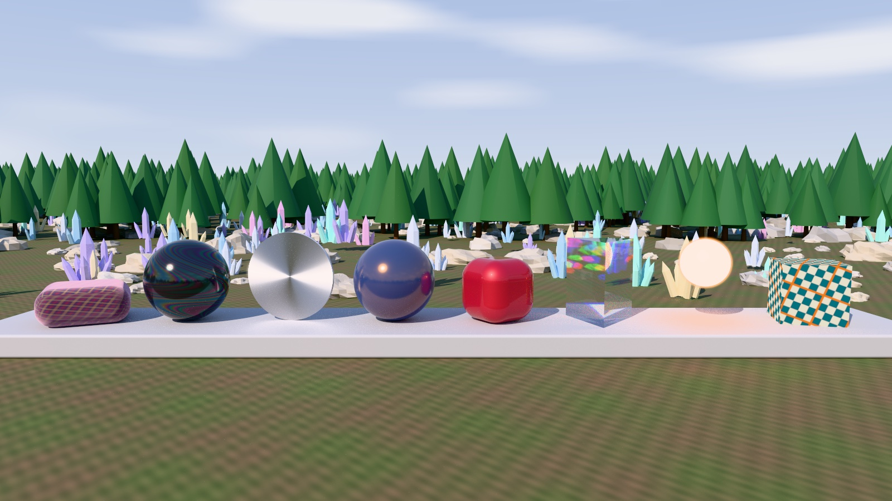

# Scale Lab: instancing, levels of detail and material extensions



The Scale Lab puts a generated field of rocks, crystals and trees behind a row
of eight hero objects. The field uses `InstanceSet`, `LevelOfDetail` and
frustum culling on the same scene nodes. The hero row shows the KHR material
extensions on `PhysicallyBasedMaterial`. One `LightRig` sun and a generated sky
light both the raster renderer and the path tracer. Every mesh, texture and the
sky are computed in code; the scene loads no files.
[Scene source](../../Examples/FrostfieldLab/FrostfieldLab/LabScaleLab.swift) ·
[Generated meshes and textures](../../Examples/FrostfieldLab/FrostfieldLab/LabScaleGeometry.swift)

## Full-resolution textures and Metal acceleration

The path view now uses full-resolution material maps when the device supports
direct sampling. The Lab uses mip-chain bloom for wide highlights. Empty
instance sets no longer force a new path scene during transform updates.
[Texture and acceleration checks](pathscale.md) · [Bloom checks](postsuite.md)

With Xcode 27.2 and Metal API Validation on an M4 Max Mac running macOS 27.2,
a 320 × 180 Debug run at `16e8ba8` traced 100,000 field objects plus 10 scene
objects with Metal acceleration. The field represented 4,250,455 instanced
triangles from 29,427 stored triangles. Six textures were sampled directly
and none were baked. The run checked that the full field renders with the
old Lab cap removed.

The images and performance measurements below come from the original Scale
Lab revision and preserve its renderer settings.

| View | Image |
| --- | --- |
| Hero row, raster, default controls | [raster](scene/scale-lab-raster.jpg) |
| Hero row, path traced, 512 samples per pixel, 6 bounces | image above |
| Hero row, raster, edited: texture tiling 5 turned −40°, sheen roughness 0.1, film 320 nm, brush turned 90°, emissive strength 30, sun at azimuth 60° and elevation 18°, sky turned 120° | [edited](scene/scale-lab-edited.jpg) |
| Field view, raster, 100,000 instances | [field](scene/scale-lab-field-100k.jpg) |

## The field

The field covers 200 × 200 m in a 16 × 16 grid of 12.5 m chunks. Each chunk
has one scene node per object kind, 768 nodes in all. Each node draws its kind
with one `InstanceSet` and chooses between three prepared meshes with
`LevelOfDetail`. Levels start at 0, 24 and 60 m, scaled by the LOD distance
control, with 0.1 hysteresis by default. The Lab calls
`SceneGraph.updateLevelsOfDetail(cameraPosition:)` once a frame. Each node
also has explicit `cullingBounds`: its chunk plus 1.6 m, from −0.6 to 5.2 m
high. The frustum test therefore never walks the instances, and an animated
chunk does not recompute its bounds.

| Kind | Level 0 | Level 1 | Level 2 |
| --- | ---: | ---: | ---: |
| Rock, displaced sphere, flat shaded | 624 triangles | 100 | 20 |
| Crystal cluster | 210 | 45 | 18 |
| Tree, trunk and tiered foliage | 156 | 22 | 14 |

Placements come from a fixed, hashed 100,000-entry sequence. A field of N
instances uses the first N entries, so smaller fields are subsets of larger
ones, and each instance set's capacity is its share of the full sequence.
Half of the crystals hover and spin. With Animate on, each frame rebuilds those
chunks with one `replaceAll` per chunk. Instance tints come from six colors per
kind, because the path tracer prepares one material per distinct instance tint
and allows 1,024 materials. Chunks that receive no instances are left out of
the graph; see the library issue under Limits.

The status line reports draws, instances and culled draws from
`SceneDrawStatistics`. The split by level and the triangle counts come from the
Lab, which repeats the frustum test with `ViewFrustum` on each chunk's bounds.
In every benchmark, the Lab's field draws plus the 10 fixed nodes matched
`SceneDrawStatistics.drawnMeshCount`.

## The hero row

| Object | Material | Controls |
| --- | --- | --- |
| Plaid cushion | `Sheen` color (1, 0.62, 0.78) over a generated plaid base color | Sheen roughness, Tiling, Texture turn |
| Black sphere | `Iridescence` factor 1, film index 1.8, 120 nm up to the control through a generated thickness map | Film nm |
| Upright disc | Metal with `Anisotropy`; a generated direction map gives circular brushing | Anisotropy, Brush turn |
| Navy sphere | `Specular` color (4.5, 2.4, 0.6), which tints dielectric reflections gold | — |
| Rounded red cube | `Clearcoat` factor 1, roughness 0.04, over rough metallic red | — |
| Triangular prism | `Transmission` factor 1, index 1.52, thickness 0.45, pale blue attenuation, `dispersion` | Dispersion |
| Orb | Emissive color (1, 0.42, 0.12) with `emissiveStrength` 14 | Emissive |
| Checker cube | `ShadingModel.unlit` with a generated checker | Tiling, Texture turn |

The cushion's plaid and the cube's checker share one
`PhysicallyBasedMaterial.TextureTransform`, set by the Tiling and Texture turn
controls. The ground uses a fixed transform with 750 repeats.

Raster rendering ignores dispersion, as the `Transmission` documentation says,
so the raster prism only refracts the opaque-scene snapshot. The path-traced
prism shows color fringes. The raster orb lights nothing around it; in the path
tracer it lights the plinth. The path tracer emits an unlit surface's base
color, so the checker cube adds a little light there too. The path-traced
image clamps scattered contributions at 40 (`maximumSampleRadiance`), which
biases it slightly darker in exchange for fewer fireflies.

## Capabilities and where they are tested

The package tests were not run for this page. The table names the suites in
`Tests/FrostfieldTests` that cover each API.

| Capability | Frostfield API | Package test suites | In the Lab |
| --- | --- | --- | --- |
| GPU instancing | `InstanceSet`, `SceneNode.instances`, `MeshRenderer(supportsInstancing:)` | `InstancingTests`, `InstanceSetValidationTests` | 764 instanced chunk nodes at 20,000 instances, up to 100,000 instances |
| Levels of detail with hysteresis | `LevelOfDetail`, `SceneGraph.updateLevelsOfDetail(cameraPosition:)` | `CullingAndLODTests` | Three levels per kind; draws per level in the status line |
| Frustum culling and draw counts | `SceneNode.frustumCulled`, `SceneNode.cullingBounds`, `SceneDrawStatistics` | `CullingAndLODTests` | Culling toggle; drawn and culled counts |
| Frustum tests | `ViewFrustum` | `ViewFrustumTests` | The Lab's per-level split |
| Orbit camera | `OrbitCameraController` | `CameraControllerTests` | Drag and zoom; Hero row and Field views |
| Sheen, iridescence, anisotropy, specular color, emissive strength, unlit, dispersion | `PhysicallyBasedMaterial.Sheen`, `.Iridescence`, `.Anisotropy`, `.Specular`, `emissiveStrength`, `ShadingModel.unlit`, `Transmission.dispersion` | `MaterialExtensionsTests`, `MaterialExtensionValidationTests` | Hero row |
| Clearcoat | `PhysicallyBasedMaterial.Clearcoat` | `ClearcoatTests`, `ClearcoatRenderingTests` | Red cube |
| Raster transmission | `Transmission`, `SceneGraph.encode(pass:commandBuffer:shadowMap:transmissionBackdrop:punctualShadowMaps:)` | `TransmissionTests`, `TransmissionRenderingTests` | Prism |
| Texture transforms | `PhysicallyBasedMaterial.TextureTransform` | `TextureTransformTests`, `TextureTransformValidationTests` | Plaid, checker and ground |
| Sun light and shadow | `LightRig`, `LightRig.directionalShadow`, `LightRig.pathLighting(sky:)`, `DirectionalShadowMap.update` | `LightRigTests`, `DirectionalShadowMapTests` | Sun & Sky controls |
| Sky intensity and rotation | `SceneGraph.environmentIntensity`, `SceneGraph.environmentRotation`, `EnvironmentBackground`, `PathTracer.Environment.map` | `SceneEnvironmentTests` for intensity; `EnvironmentBackgroundTests` and `PathEnvironmentTests` for yaw | Sky and Sky turn. No test sets `environmentRotation` itself |
| Two-level refit | `PathTracingScene.updateTransforms(_:)`, `PathTracingScene.statistics` | `PathSceneUpdateTests` | Spinning crystals and heroes refit every frame |
| Path-traced instances and levels | `PathTracingScene(queue:graph:textureSize:)` with instanced level-of-detail nodes | `InstancingTests`, `CullingAndLODTests` | 20,010 traced instances |
| Trace timing | `PathTracer.Timing` | `PathSamplingTests` | Trace time in the status line |
| Bloom | `PostProcessChain`, `ScreenEffects` | `ScreenEffectsTests`, `PostProcessChainTests` | Bloom and Bloom radius |

## Measured on one Mac

These are offscreen measurements from the Release FrostfieldLab app on an
Apple M4 Max Mac Studio (Mac16,9, 36 GB) with macOS 27.2 (26B123) and Xcode
27.2 (27B52), with Metal API Validation off. They use the harness in
[Lab scene benchmarks](lab-benchmarks.md): one command buffer in flight, a wait
for each frame, 30 warm-up frames skipped, and CPU encode time plus GPU time
from command-buffer timestamps. CPU encode time covers all CPU work in a
frame: animation, level selection, graph encoding, the Lab's statistics and,
in path mode, the refit. The camera is the default hero view and Animate is on
unless noted.

Raster at 1920 × 1080, 300 frames:

| Field | Culling | Instances drawn | Draws (culled) | Triangles drawn | GPU p50 | GPU p95 | GPU p99 | CPU encode p50 | CPU encode p95 |
| ---: | --- | ---: | ---: | ---: | ---: | ---: | ---: | ---: | ---: |
| 20,000 | on | 5,489 | 222 (552) | 290,515 | 1.00 ms | 1.47 ms | 1.78 ms | 1.29 ms | 1.42 ms |
| 20,000 | off | 20,010 | 774 (0) | 881,380 | 1.28 ms | 1.82 ms | 2.00 ms | 1.83 ms | 2.05 ms |
| 100,000 | on | 27,164 | 222 (552) | 1,289,363 | 2.35 ms | 3.21 ms | 3.57 ms | 2.34 ms | 2.98 ms |
| 100,000 | off | 100,010 | 774 (0) | 4,250,455 | 3.71 ms | 4.58 ms | 5.17 ms | 2.85 ms | 3.10 ms |

Drawn instances and draws include the 10 fixed nodes: ground, plinth and eight
heroes. With culling, field draws by level were 14, 48 and 150; without it, 38,
174 and 552. Every run drew 82 caster draws into the sun's shadow map and
skipped 690 outside its view, because camera culling does not apply to shadow
casters. Moving the hovering crystals cost 0.25 ms of CPU time per frame at
20,000 instances and 1.2 ms at 100,000. Device allocation was 169 MB.

Path traced at 1280 × 720, 120 frames, 1 sample per pixel per frame, 6 bounces,
20,000 field instances:

| Mode | GPU p50 | GPU p95 | GPU p99 | CPU encode p50 | CPU encode p95 | Scene updates |
| --- | ---: | ---: | ---: | ---: | ---: | --- |
| Animated: refit and restart every frame | 42.85 ms | 44.60 ms | 44.99 ms | 5.62 ms | 6.27 ms | 149 top-level refits, no rebuild; `updateTransforms` mean 4.76 ms |
| Still: accumulates to 150 samples per pixel | 42.65 ms | 44.73 ms | 45.76 ms | 3.15 ms | 6.44 ms | No refits |

The traced scene held 20,010 instances over 19 bottom levels: 29,427 stored
triangles and 881,380 instanced triangles, 10,100,804 bytes of buffers and
4,227,072 bytes of baked textures. Preparing it took 36.0 ms in the animated
run and 33.8 ms in the still run. `PathTracer.Timing` measured the last
tracing pass at 43.85 ms and 41.81 ms, in line with the command-buffer GPU
times. In the still run, CPU time includes `updateTransforms` checking every
instance and finding no change. Device allocation was 181 MB.

Raw results: [raster 20k](data/lab-bench-scale-raster-20k.json) ·
[raster 20k, no culling](data/lab-bench-scale-raster-20k-nocull.json) ·
[raster 100k](data/lab-bench-scale-raster-100k.json) ·
[raster 100k, no culling](data/lab-bench-scale-raster-100k-nocull.json) ·
[path, animated](data/lab-bench-scale-path-animated.json) ·
[path, still](data/lab-bench-scale-path-still.json)

Each JSON file has a `details` object with the scene's counts from the last
frame: draws, culled draws and instances per level for raster runs, and
`PathTracingScene.statistics`, build and refit counts, and the trace timing
for path runs.

## Edit behavior

| Change | Raster | Path tracer |
| --- | --- | --- |
| Animation | Next frame; one `replaceAll` per animated chunk | `updateTransforms` refits the top level; accumulation restarts |
| Instance count | `replaceAll` on every chunk's set | New `PathTracingScene` |
| LOD distance or hysteresis, or a chunk crossing a level boundary as the camera moves | Next frame | New `PathTracingScene` when a traced node's level changes |
| Culling | Next frame | No effect; the tracer traces every instance |
| Hero material controls | New `MeshRenderer` for that hero only | New `PathTracingScene` |
| Sun and sky | Next frame | New `Lighting`; accumulation restarts |
| Exposure and bloom | Post and display only | Post and display only |

## Runtime checks

| Check | Result |
| --- | --- |
| Debug and Release builds, macOS arm64 | Succeeded. The only warnings were two existing pixel-format deprecations in `Sources/Frostfield/PostProcessPass.swift` |
| Raster and path-traced captures, Debug, Metal API Validation | Completed with no validation errors; the images on this page |
| Live window, Debug, Metal API Validation | `--scale-lab` submitted 420 raster frames in about 12 seconds with no frame errors, then was closed |
| Path tracing in a live window | Not run; captures and benchmarks exercised the same encode path |
| iPhone, iPad and Vision Pro, simulator or device | Not run |

The Xcode bridge's DerivedData is on a full external volume, so the builds used
`xcodebuild` with DerivedData on the internal drive. The Lab project derives
its package name from the package folder, so the branch was built from a copy
in a folder named `Frostfield`.

```sh
xcodebuild build -project Examples/FrostfieldLab/FrostfieldLab.xcodeproj -scheme FrostfieldLab \
  -configuration Release -destination 'platform=macOS,arch=arm64' \
  -derivedDataPath ~/Library/Developer/Xcode/DerivedData/ff-scalelab
FrostfieldLab.app/Contents/MacOS/FrostfieldLab --scale-lab
MTL_DEBUG_LAYER=1 FrostfieldLab.app/Contents/MacOS/FrostfieldLab --capture-scale-lab /tmp/raster.png 1600 900
MTL_DEBUG_LAYER=1 FrostfieldLab.app/Contents/MacOS/FrostfieldLab --capture-scale-lab /tmp/path.png 1600 900 --set scene.path=1 --set scene.samples=512
MTL_DEBUG_LAYER=1 FrostfieldLab.app/Contents/MacOS/FrostfieldLab --capture-scale-lab /tmp/field.png 1600 900 --set scene.view=1 --set field.count=100000
MTL_DEBUG_LAYER=1 FrostfieldLab.app/Contents/MacOS/FrostfieldLab --capture-scale-lab /tmp/edited.png 1600 900 --set tex.tiling=5 --set tex.turn=-40 --set mat.sheen=0.1 --set mat.film=320 --set mat.anisoTurn=90 --set mat.glow=30 --set sun.azimuth=60 --set sun.elevation=18 --set sky.rotation=120
FrostfieldLab.app/Contents/MacOS/FrostfieldLab --benchmark-scale-lab /tmp/raster.json 300 1920 1080 --set field.count=100000 --set field.culling=0
FrostfieldLab.app/Contents/MacOS/FrostfieldLab --benchmark-scale-lab /tmp/path.json 120 1280 720 --set scene.path=1 --set scene.samples=2048
FrostfieldLab.app/Contents/MacOS/FrostfieldLab --benchmark-scale-lab /tmp/still.json 120 1280 720 --set scene.path=1 --set scene.samples=2048 --set field.animate=0
```

Captures advance no time, so path-traced captures accumulate even with Animate
on. A capture prints the status line to standard error.

## Limits and findings

- Each configuration ran once on one Mac, so the numbers show the order of
  cost, not a stable distribution. They are not iPhone, iPad or Vision Pro
  measurements, and no comparison with Three.js was made.
- The original path view capped the field at 64,000 instances because
  `PathTracingScene` then supported 65,536 instances.
- Raster shadows cover only the ground around the orbit target: a half extent
  of 0.9 times the orbit distance, at least 18 m. Casters outside it cast no
  raster shadow. The path tracer shadows the whole field.
- Orbiting in path mode can change a chunk's level, which prepares a new traced
  scene (about 35 ms in Release at 20,000 instances). A refit handles only
  motion.
- The original renderer had a library issue. If a mesh node's `InstanceSet` was empty when a
  `PathTracingScene` is prepared, every later `updateTransforms(_:)` on that
  graph throws `structureChanged` for the node, even when nothing moved.
  Preparation records no instances for the node, and the update then treats it
  as a new node. In the Lab with 1,000 instances, keeping the empty chunks in
  the graph gave 10 scene builds and no refits over 10 frames, and each throw
  named a node with zero instances. Leaving them out gave one build and nine
  refits. The Lab leaves empty chunks out.
- The original Lab used `ScreenEffects` bloom with one five-tap separable pass
  whose taps are `bloomRadius / 2` full-resolution pixels apart. With a radius
  of 10, a one-pixel sun highlight on the clear coat became a 5 × 5 grid of
  separate dots. Radii of 3 and 4 blurred smoothly, so the Lab defaults to 4.
- The status line formats numbers for the current locale.
