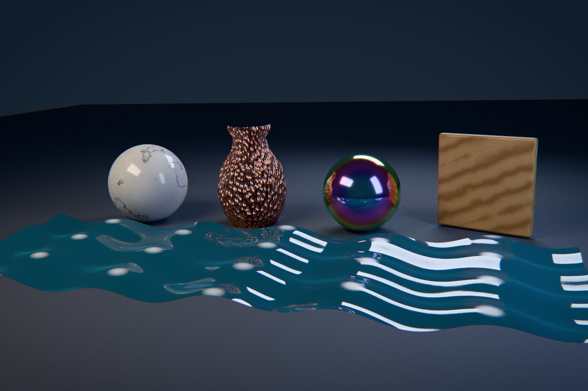
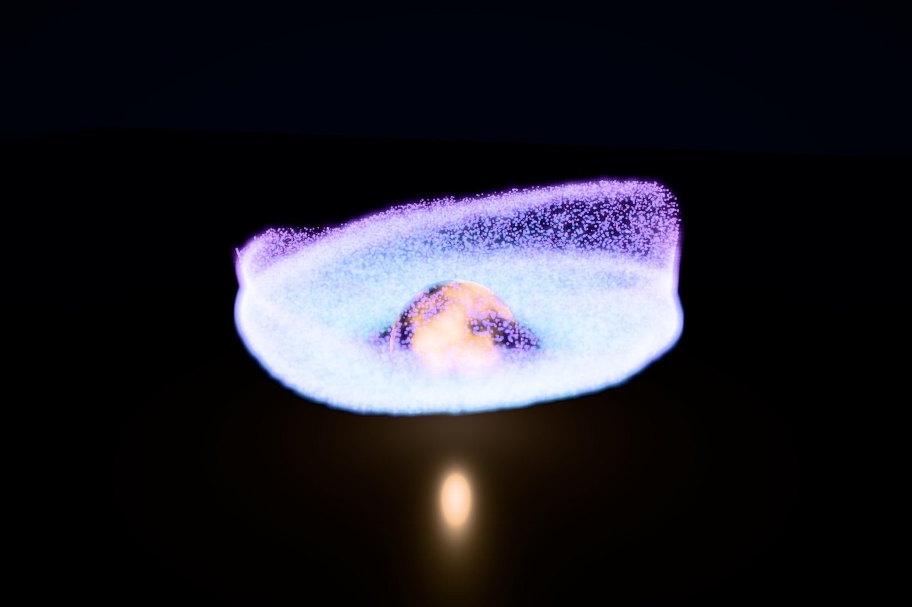

# Shader graph authoring



The Shader Lab builds five objects whose finishes and motion come from Swift
shader graphs. The marble warps sine bands with fractal noise. The hammered
vase derives a tangent-space normal from finite differences of cellular noise.
The thin-film sphere shifts hue with the viewing angle. The tile samples a
wood texture that a compute graph generated on the GPU, through a graph-authored
tiling and rotation. The pool displaces its vertices with two travelling waves
and colors the crests from the deformed height. A post-process chain applies a
graph-authored split tone, chromatic fringing, and a vignette.
[Scene source](../../Examples/FrostfieldLab/FrostfieldLab/LabShaderLab.swift)

The [raster view](scene/shader-lab-raster.jpg) and the path-traced view above
use the same graphs, uniforms, and generated texture. The path-traced still
uses 256 samples per pixel at 1440 × 960 and up to six bounces.

## Procedural effects



The Effects Lab shades a core with an animated fractal-noise surface graph and
swirls 65,536 particles around it. A `BufferShaderGraph` steps every particle
each frame: expired particles respawn on a ring from hashed directions, and
living ones swirl, lift, and drift through gradient noise. `ShaderParticleSystem`
draws them as soft additive quads that test against scene depth, and a
`PostProcessChain` adds bloom, a split tone, and a vignette.
[Scene source](../../Examples/FrostfieldLab/FrostfieldLab/LabEffectsLab.swift) ·
`ShaderParticleSystemTests` verifies a graph step and the drawn quad on the GPU.

## What the graph system provides

| Capability | API | Verified by |
| --- | --- | --- |
| Typed values: scalar, vector2, vector3, vector4, with swizzles and constructors | `MaterialGraph.Node`, `ShaderGraphBuilder`, `ShaderValue<T>` | `ShaderGraphLanguageTests` |
| Vector math, conversions, lattice, fractal and cellular noise | `.unary`, `.binary`, `.clamp`, `.select`, `.remap`, `.latticeNoise`, `.fractalNoise`, `.cellularNoise` | GPU evaluation of every operation family |
| Editable uniforms with a revision, including 3 × 3 and 4 × 4 matrices | `ShaderUniform`, `ShaderUniforms` | `ShaderGraphRenderingTests`, `ShaderGraphLanguageTests`, `ShaderPatternTests.matrixUniforms` |
| Texture sampling by declared slot with addressing and filtering, an explicit mip level, explicit UV derivatives, compute cube faces, and compute 3D coordinates | `ShaderTextureInput`, `ShaderTexture.sample`, `ShaderTexture.sample(_:level:)`, `ShaderTexture.sample(_:ddx:ddy:)`, `ShaderGraphBuilder.cube`, `ShaderGraphBuilder.texture3D` | `ShaderPatternTests.textureLevel`, `ShaderPatternTests.textureGradient`, `ShaderPatternTests.cubeTexture`, `ShaderPatternTests.texture3D`, cross-renderer stripe test |
| Caller-written Metal functions | `ShaderFunction` | GPU evaluation, compiler diagnostics test |
| Surface outputs: base color, metallic, roughness, emission, transmission mask, tangent-space normal, occlusion | `SurfaceShaderGraph.Outputs` | `ShaderGraphRenderingTests` |
| Vertex deformation with rebuilt normals in color, shadow, picking, and path-tracing snapshots | `Outputs.positionOffset`, `MeshRenderer.deformedGeometry(queue:)` | `MeshDeformationTests` |
| Post-processing graphs and a composable chain | `PostProcessGraph`, `PostProcessPass`, `PostProcessChain` | `PostProcessGraphTests`, `PostProcessChainTests` |
| Graph-simulated GPU particles drawn as soft quads | `ShaderParticleSystem` | `ShaderParticleSystemTests` |
| Compute graphs that generate textures, PBR maps, and buffer updates | `TextureShaderGraph`, `ShaderTextureGenerator`, `ShaderMaterialMaps`, `BufferShaderGraph`, `ShaderBufferKernel` | `ComputeShaderGraphTests`, `ShaderMaterialMapsTests`, `BufferShaderGraphTests` |
| Indirect buffer-graph dispatch | `ShaderBufferKernel.encode(indirect:from:to:commandBuffer:)`, `ShaderBufferKernel.IndirectArguments` | `IndirectDispatchTests` |
| Inspectable Metal and diagnostics | `metalFunction(named:)`, `metalVertexFunction(named:)`, `supportSource`, compiler errors that quote the generated line | `ShaderGraphLanguageTests`, `ComputeShaderGraphTests` |
| One compile per generated source and device | `ShaderLibraryCache` (package) | Compile counts unchanged after uniform edits and scene re-preparation |
| Branches, loops, oscillators, coordinate utilities, triplanar and parallax mapping, derivatives, matrices, bit operations, dithering, the graph clock, camera, model and screen inputs, and CPU noise | See [Shader graph language](graphlang.md) | `ShaderControlFlowTests`, `ShaderPatternTests`, `ShaderNoiseTests`, `ShaderGraphInputTests` |

Each generated statement ends with a `// node N` marker and optional label, so a
Metal compiler error names the node it came from. The Lab's **Metal** button
shows the generated surface and vertex functions for the selected object.

`ShaderBufferKernel.encode(indirect:)` reads a 16-byte record: three threadgroup counts, then the element count. Metal uses the counts for the dispatch, and the kernel uses the element count, capped to the space in the source and destination. A compute encoder earlier in the same command buffer can write the record. The threadgroup is `indirectPipelineState.threadExecutionWidth` wide and one thread tall. The y and z counts should be 1, because the element index is the grid's x index. Passing an element count to `encode(elementCount:)` still dispatches that count directly.

Uniform edits never rebuild a pipeline. Raster draws copy the current values
into each draw. The path tracer copies them into each dispatch and rejects stale
accumulation through `PathTracer.Failure.surfaceUniformsChanged`. A test edits a
tint and re-prepares the path-tracing geometry, and the library compile count
for that graph stays at one raster and one path library.

## Platform runs

| Runtime | Observed |
| --- | --- |
| M4 Max Mac Studio, macOS 27.2 | Raster and 256-sample path captures with Metal API Validation. |
| iPhone 18 Pro Simulator, iOS 27.2 | [Live scene and inspector](scene/shader-lab-iphone.jpg) with Metal API Validation. |
| iPad Pro 13-inch (M5) Simulator, iPadOS 27.2 | [Live scene and inspector](scene/shader-lab-ipad.jpg) with Metal API Validation. |
| Apple Vision Pro Simulator, visionOS 27.2 | [Windowed scene and inspector](scene/shader-lab-vision.jpg) with Metal API Validation. |

The simulator runs found two portability defects that the Mac had accepted.
Mesh deformation used non-uniform threadgroup dispatch, which the Simulator's
GPU family rejects, and sRGB compute output wrote through a texture view
without `.pixelFormatView` usage. Both are fixed and covered by tests.
Physical iPhone, iPad, and Vision Pro performance remains unmeasured.

```sh
FrostfieldLab.app/Contents/MacOS/FrostfieldLab --capture-shader-lab /tmp/raster.png 1440 960
FrostfieldLab.app/Contents/MacOS/FrostfieldLab --capture-shader-lab /tmp/path.png 1440 960 --set scene.path=1 --set scene.samples=256
```

Launch with `--shader-lab` for the live scene. Every slider edits a uniform.
`--set ID=VALUE` applies an inspector value to a capture or benchmark.
