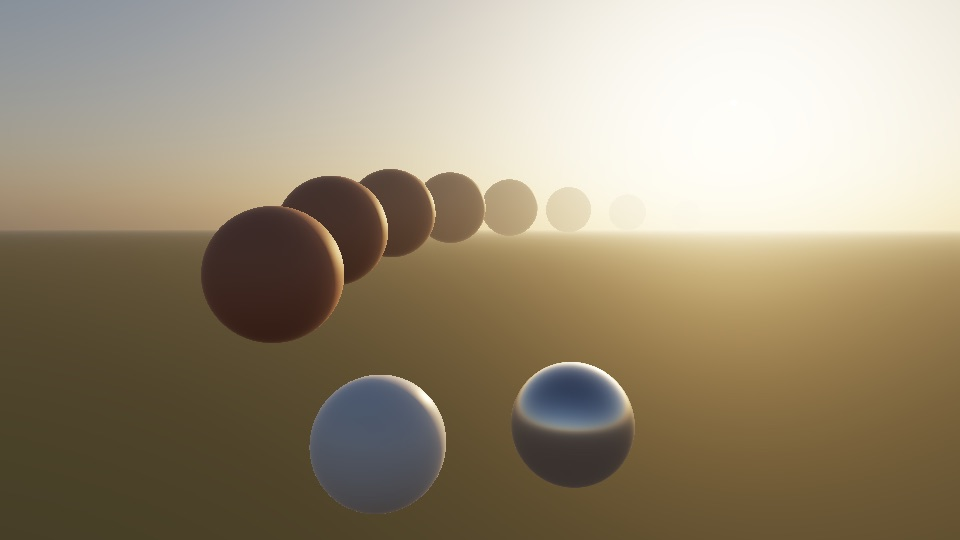

# Physical sky, sun and atmosphere



Interlaken, 21 June 2026 at 20:15 local time: `SolarPosition` puts the Sun
9.7° above the horizon at azimuth 294°. One `SkyEnvironment` built from
turbidity 3 and a ground albedo of 0.2 lights the scene. The raster frame
uses its image-based lighting and sun light, then `AerialPerspective` adds the
sky, the solar disk and haze. The farthest sphere is 19 km away. Compare the
[raster frame before aerial perspective](scene/sky-scene-raster.jpg) and the
[path-traced frame](scene/sky-scene-path.jpg), which uses the same sky map
and sun at 512 samples per pixel. The path tracer has no haze. The
[panorama sheet](scene/sky-panoramas.jpg) shows Sun elevations of 60°, 20°,
5°, 1° and −3°. Each row is exposed for its own horizon.

## Capabilities

| Capability | Public API | Raster | Path tracer | Verified by |
| --- | --- | --- | --- | --- |
| Sun position from date, time, time zone, latitude and longitude (NOAA equations, refraction, Earth–Sun distance) | `SolarPosition(localTime:timeZone:latitude:longitude:)`, `init(date:…)`, `init(julianDay:…)`, `direction()` | — | — | `SolarPositionTests` |
| Clear-sky atmosphere: Rayleigh, aerosols with Henyey–Greenstein phase, ozone, Lambertian ground, Ångström exponent, turbidity | `SkyModel`, `SkyModel.Atmosphere`, `Atmosphere(turbidity:)` | — | — | `SkyModelTests` |
| Direct solar beam: ASTM G-173 spectrum, Beer–Lambert extinction, 1/R², Sun's angular size | `SkyModel.sunIlluminance`, `sunAngularRadius`, `sunLight()` | Directional `LightRig` light | Analytic sun disk through `LightRig.pathLighting` | `SkyModelTests`, `SkyEnvironmentTests` |
| HDR sky panorama, ray-marched per texel at 16 wavelengths, single plus multiple scattering | `SkyEnvironment(queue:model:settings:)`, `panorama` | `lighting` (`EnvironmentLighting`), `materialEnvironment()` | `pathMap`, `pathEnvironment` | `SkyEnvironmentTests` |
| Sky irradiance and energy closure | `skyIlluminance`, `sunIlluminance` | Diffuse IBL plus sun | Importance-sampled map plus sun | `SkyEnvironmentTests` |
| Aerial perspective from depth, sky background, limb-darkened solar disk | `AerialPerspective(environment:)`, `encode(source:depth:destination:camera:…)` | Post pass after the scene | Not available | `AerialPerspectiveTests` |

One call prepares both renderers:

```swift
let position = try SolarPosition(localTime: components, timeZone: zone, latitude: 46.5, longitude: 7.9)
let model = try SkyModel(solarPosition: position, atmosphere: .init(turbidity: 3), luminanceScale: 0.001)
let sky = try SkyEnvironment(queue: queue, model: model)
let rig = try LightRig(lights: [sky.sunLight()])
let material = try PhysicallyBasedMaterial(roughness: 0.6, lightIntensity: 0, environment: sky.materialEnvironment())
let nodes = try rig.sceneNodes()                                     // raster sun
let lighting = try rig.pathLighting(sky: sky.pathEnvironment)        // path-traced sky and sun
try AerialPerspective(environment: sky).encode(source: color, depth: depth, destination: output,
                                                camera: camera, cameraTransform: view, commandBuffer: buffer)
```

## Model

The atmosphere uses the parameters of Bruneton's 2017 reference
implementation: a 6,360 km planet, a 60 km atmosphere, Rayleigh scattering
1.24062 × 10⁻⁶ λ⁻⁴ m⁻¹ with an 8 km scale height, aerosols with a 1.2 km
scale height, single-scattering albedo 0.9 and asymmetry 0.8, and a 300 DU
ozone layer from 10 to 40 km. `Atmosphere(turbidity:)` sets the aerosol
optical depth to `(T − 1) τ_Rayleigh(550 nm)` with an Ångström exponent of 1.3.

Preparation builds a 256 × 64 optical-depth table in Bruneton's (r, μ)
parameterization and a 32 × 32 table of Hillaire's multiple-scattering
transfer Ψ_ms. The Ψ_ms sphere integral uses 12 Gauss–Legendre cosine nodes on
each side of the horizon and 24 azimuths. Each panorama texel then ray-marches
64 steps on a quadratic partition, integrating every step exactly for its
extinction. Spectra are sampled at 16 wavelengths from 400 to 700 nm and
converted to linear sRGB with the CIE 1931 observer. The solar spectrum and
ozone cross sections are Bruneton's 10 nm tables (BSD 3-clause; attribution
in `SkyModel.swift`). The Hosek–Wilkie dataset is not used.

The panorama holds sky radiance only. The Sun is a directional light carrying
the transmitted beam and the solar disk's 0.533° diameter. Both renderers
therefore add sky and Sun once. Below the horizon, the panorama shows the
ground through the atmosphere. The Sun and the sky's computed horizontal
irradiance light that ground.

Units are photometric times the explicit `luminanceScale`. A scale of 0.001
gives kilocandela per square meter and kilolux. Apply the same scale to other
lights in the rig. A scale of one gives physical
units, but hazy skies then exceed the 65,504 half-float limit near the Sun.
Preparation throws `radianceRange` rather than clipping.

## Measured accuracy

All values were measured on an M4 Max Mac Studio with macOS 27.2, Xcode 27.2
(27B52), and Metal API Validation. Each accuracy and validation test also
failed when the code under test was deliberately broken. That check covered
phase functions, the ozone profile, the irradiance normalization, the
multiple-scattering series, transmittance, disk normalization, input
validation, the equation of time, nutation and the 1/R² factor. The uniform
layout check was not part of it.

| Check | Reference | Result |
| --- | --- | --- |
| Solar zenith and azimuth, Golden CO, 2003-10-17 12:30:30 UTC−7 | NREL SPA (Reda & Andreas 2008): 50.11162°, 194.34024° | −0.0030°, +0.0023°; equation of time +0.005 min |
| Apparent longitude, right ascension, declination, distance, equation of time, 1992-10-13 0h | Meeus, Examples 25.a and 28.b | within 0.0005° and 10⁻⁵ AU; 13.711 vs 13.71 min |
| Luminous solar constant from 16 samples | 132,603 lx from the 10 nm table; 133,334 lx (Darula et al. 2005) | 132,508 lx; chromaticity within 0.001 of (0.3219, 0.3310) |
| Vertical transmittance | Closed-form exponential and ozone columns | within 10⁻⁶ (CPU); GPU table within 0.05% |
| Slant and horizon optical depths, GPU table | Independent 3D double-precision integration | within 0.2% at 7 texels |
| Single-scattered sky radiance, 7 directions including 0.7° above the horizon | Double-precision 3D ray march, 2,000 steps | max 0.19% |
| Ψ_ms at 0, 1.9, 7.7 and 19 km, 16 wavelengths | Gauss–Legendre sphere integral, direct optical depths | max 0.36% |
| Zenith radiance with multiple scattering | Reference single scattering plus σ_s Ψ_ms | max 0.26% |
| Horizontal sky irradiance | Panorama integrated over the upper hemisphere vs the GPU's 2,048-direction multiple importance estimate | within 0.27% for the plane fixture |
| White Lambertian plane under sky plus Sun (turbidity 2, Sun 50°) | `(E_sky + E_sun cos θ) / π` | raster within 0.21%, path tracer (1,024 spp) within 0.05% |
| Ground radiance below the horizon | Double-precision scattering plus Lambertian ground | max 0.09% at six sampled directions |
| Wall lit by sky, ground and Sun | Independent panorama integral over the visible hemisphere plus the transmitted solar beam | raster within 0.10%, path tracer within 0.03% |
| Camera-height-dependent background | Independent ray march at model altitude, 300 m higher, and 10 km higher | max 1.01% across 162 sampled rays |
| Aerial perspective, 4–4.2 km wall, 3 pixels | Reference transmittance and in-scattering along each pixel ray | max 0.11% |
| Solar disk, 151 × 151 view | Integral over pixel solid angles vs `sunIlluminance` | +0.25% |
| Limb darkening, disk center | Σ (α + 2) / 2 spectral weighting | within 0.08%; center to mean 1.22 (R), 1.26 (G), 1.32 (B) |

At turbidity 2 with the Sun 60° high, the model gives zenith luminance
4.18 kcd/m². It also gives 17.0 klx of sky illuminance and 100.3 klx direct
normal illuminance, so the global horizontal value is 103.9 klx with 16%
diffuse. These are model outputs, not measurements. Preetham's empirical
zenith formula gives 5.88 kcd/m² for the same turbidity and Sun angle.

## Earlier performance measurements

Release build on the M4 Max before the camera-height-dependent sky table:

| Work | Time |
| --- | --- |
| `SkyEnvironment` with a 1,024 × 512 panorama: GPU tables and panorama | 21 ms GPU |
| Same, including `EnvironmentLighting` (256 cube) and the path map's sampling tables | 36 ms wall |
| 2,048 × 1,024 panorama | 39 ms GPU, 105 ms wall |
| `AerialPerspective` at 1920 × 1080, including the 64³ froxel update | 0.39 ms GPU |
| `AerialPerspective` at 3840 × 2160 | 0.59 ms GPU |

Moving the Sun means preparing a new `SkyEnvironment`. That costs tens of
milliseconds, so it suits time-of-day changes but not per-frame animation.

## Compared with Three.js

| Reference | Frostfield | Remaining behavior |
| --- | --- | --- |
| Three.js r187 [`Sky`](https://github.com/mrdoob/three.js/blob/r187/examples/jsm/objects/Sky.js) and [`SkyMesh`](https://github.com/mrdoob/three.js/blob/r187/examples/jsm/objects/SkyMesh.js) | Clear-sky spectral atmosphere, raster sky and solar disk, a prepared map for both renderers, and a directional sun light | Animated clouds and live sun changes without rebuilding the environment |
| drei `<Sky>` | `SolarPosition` resolves a direction from civil time and coordinates, and `SkyModel` also accepts a direction | Animated clouds, stars, and sparkles are separate gaps |
| `@takram/three-atmosphere` | Spectral sky, camera-height-dependent raster aerial perspective, and a path-tracing environment map | Moon, stars, clouds, globe placement and path-traced atmosphere |

## Limits

- Hillaire's approximation treats second and higher scattering orders as
  isotropic. The tests confirm that the implementation matches the model. They
  do not validate the model against measured skies or a radiative-transfer
  code such as libRadtran.
- Light paths are straight. Only the reported Sun direction includes
  atmospheric refraction. Earth's shadow uses the Sun's center, so the disk is
  not clipped at the horizon. There are no clouds, Moon, stars or airglow,
  and twilight beyond about −6° is not modeled.
- The panorama's ground is a flat Lambertian surface lit by the irradiance at
  the world origin. Spectra end at 400 and 700 nm with constant tails. Colors
  outside the sRGB gamut clamp to zero.
- Escaping camera and scattered rays see the Sun's uniform directional disk.
  The raster limb-darkened disk and `AerialPerspective` still use a stored
  Depth32Float buffer. [Path solar disk evidence](path-generated-environments.md)
- Aerial perspective does not shadow in-scattered light by scene geometry, so
  it has no light shafts. Its 64³ froxels run to `maximumDistance`, 100 km by
  default, and farther surfaces use that value. Spectral transmittance becomes
  RGB through a sunlight-weighted channel response. Geometry below the
  planet's surface receives ground-level haze.
- At a scale of 0.001 the solar disk exceeds the half-float range and
  saturates at 65,504. Limb darkening is visible only at
  `luminanceScale` ≤ 3 × 10⁻⁵.
- The four sky suites (16 tests) passed on the iPhone 18 Pro Max Simulator
  (iOS 27.2) with Metal API Validation. The visionOS Simulator build passed but
  was not run. Physical iPhone, iPad and Vision Pro timings are not measured.

## Reproduce

```sh
TEST_RUNNER_MTL_DEBUG_LAYER=1 xcodebuild test -scheme Frostfield-Package -destination 'platform=macOS,arch=arm64' \
  -only-testing:FrostfieldTests/SolarPositionTests -only-testing:FrostfieldTests/SkyModelTests \
  -only-testing:FrostfieldTests/SkyEnvironmentTests -only-testing:FrostfieldTests/AerialPerspectiveTests
# Evidence images (PNG) into a directory:
TEST_RUNNER_FROSTFIELD_SKY_CAPTURE=/tmp/sky xcodebuild test -scheme Frostfield-Package \
  -destination 'platform=macOS,arch=arm64' -only-testing:FrostfieldTests/SkyCaptureTests
```
